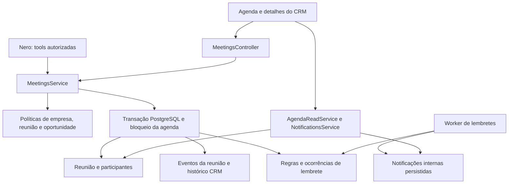

# Revisão e arquitetura restante do CRM — agenda comercial

Data da revisão: 13/10/2026. Estado: proposta de conclusão; agendamento ainda não ativado.

Referências funcionais: `ArquivosMD/crm-001-especificacao-funcional.md` e `ArquivosMD/crm-002-planejamento-funcional.md`. Evidência técnica: schema Drizzle, serviços CRM, módulo Nest, migrações, worker e ferramentas do Nero existentes.

## 1. Estado verificado

| Parte | Estado atual | Limite da entrega |
| --- | --- | --- |
| Núcleo de leads e oportunidades | Implementado e integrado ao módulo CRM | Cadastro de cliente continua sendo ação explícita |
| Frontend do banco de leads | Implementado | Visão atual é lista com contadores; calendário e Kanban ainda precisam de telas próprias |
| Agenda: modelo de dados | Declarado em `schema.ts` | Sem migration para as novas tabelas |
| Agenda: validação e serviço | Implementação parcial | Serviço ainda não registrado no `CrmModule`; controller ausente |
| Histórico da agenda | Código parcial | Referencia `meeting_id` e tabelas que não existem no banco atual |
| Lembretes | Regras declaradas e gravação prevista | Sem processamento, notificações ou leitura de notificações |
| Nero para CRM/agenda | Planejado | Ferramentas atuais consultam vendas e solicitam esclarecimentos; não agendam reuniões |
| Google Calendar | Evolução prevista | Nenhum conector de calendário implementado |

Consulta somente de leitura ao banco local confirmou `crm_meetings = NULL` e ausência de `crm_activities.meeting_id`. Swagger do contêiner atual confirmou zero rotas de reuniões. O contêiner saudável não comprova que o código novo de agenda foi instalado.

Nesta revisão foram corrigidos: validação da listagem usando `from/to` e colisão entre a propriedade injetada `history` e o método de histórico. Foram adicionados sete testes de contrato; todos passaram. TypeScript da API e do pacote de banco passou. Esses resultados não substituem testes de integração do serviço.

## 2. Achados que devem ser resolvidos antes da ativação

| Prioridade | Evidência no código | Problema | Correção planejada |
| --- | --- | --- | --- |
| Bloqueador | `crm-history.service.ts`, `schema.ts`, migrations até 0016 | Histórico existente passa a consultar campos/tabelas ausentes se a API for reconstruída agora | Gerar e aplicar migration aditiva antes de publicar API/worker; testar histórico existente |
| Bloqueador | `crm.module.ts` | `MeetingsService` não tem provider nem controller | Registrar serviços/controller e publicar contratos Swagger |
| Alta | `MeetingsService.create`, `reschedule`, `update` | Consulta de conflito e gravação não serializam a agenda do responsável; transações de contatos diferentes podem aceitar sobreposição | Bloqueio transacional compartilhado por empresa/responsável em toda mutação que ocupa horário |
| Alta | `MeetingsService.status` | Voltar para SCHEDULED não verifica conflitos nem revalida responsável/vínculos | Comando explícito de reabertura com versão, autorização e confirmação de conflito |
| Alta | `MeetingsService.create` | Replay consulta por chave da empresa antes de checar acesso à reunião; namespace não inclui ator | Namespace por usuário, hash canônico e revalidação da reunião antes de devolver replay |
| Alta | `MeetingsService.get` e políticas CRM | Responsável da reunião pode receber título/status de oportunidade sem `opportunityScope`; já o histórico exige acesso ao contato e pode ficar inacessível a esse responsável | Definir acesso à reunião e acesso à negociação separadamente; esconder oportunidade privada; liberar somente o contexto mínimo do contato necessário ao compromisso |
| Alta | `MeetingsService.updateSettings` | Lê versão e grava sem lock ou condição da versão no UPDATE | Lock da linha ou UPDATE com versão esperada e verificação do retorno |
| Alta | `replaceParticipants`, `replaceReminders`, `update` | Remove registros anteriores e grava frase genérica como `before`; não permite recuperar o conteúdo anterior | Eventos com snapshots reais antes/depois e conservação do histórico de entregas |
| Alta | `reschedule` e worker ausente | Lembretes enviados voltam a PENDING; inexistem revisão do horário e consumidor | Regras de lembrete separadas das ocorrências; nova revisão para reagendamento; entrega única e validação de estado |
| Média | `changedFields` utilizado no reagendamento | Date compara referência; mesmo instante pode produzir falsa alteração/versão | Comparar datas pelo instante e coleções por representação canônica |
| Média | `meeting.schemas.ts` | Fuso aceita qualquer texto; URL aceita protocolos além de HTTP/HTTPS | Validar fuso IANA e restringir protocolos de link |
| Média | `update/status/reschedule` | Atualizações posteriores não renovam atividade da oportunidade e não definem edição de registro encerrado/arquivado | Política explícita para manutenção histórica; atividade consistente e nenhuma reabertura comercial automática |

Falhas de concorrência e autorização acima resultam de inspeção do código. Precisam de testes com PostgreSQL para comprovar as correções; ainda não foram verificadas como comportamento em execução.

## 3. Decisões funcionais propostas para a agenda

- Uma reunião comercial pertence a uma empresa e tem um lead obrigatório; oportunidade opcional. Compromissos gerais sem lead serão outro requisito, se necessário.
- Responsável obrigatório, por padrão o usuário que agenda. Gestores podem atribuir outros membros ativos.
- Modalidades: IN_PERSON e ONLINE. Local/link podem ser completados posteriormente; só link HTTP/HTTPS será aceito.
- Horários enviados em ISO 8601 com offset explícito. Banco armazena instantes em `timestamptz`, preservando fuso IANA para apresentação.
- Intervalos usam `[início, término)`: duas reuniões encostadas no mesmo horário não conflitam.
- Conflito padrão exige confirmação: HTTP 409 com código MEETING_TIME_CONFLICT; confirmação reenvia `allowConflict: true` e reconsulta a agenda. A sobreposição confirmada fica auditada.
- A checagem inicial será da agenda do responsável dentro da empresa selecionada. Conflitos de participantes e conflitos entre empresas são extensões; não serão prometidos como parte dessa checagem.
- Estados próprios: Agendada, Realizada, Cancelada e Não compareceu. Reabertura é comando explícito; mudança de reunião nunca perde, ganha ou reabre negociação por consequência.
- Agendar qualifica somente a oportunidade explicitamente vinculada em NEW/CONTACTING, quando a configuração da empresa permite. Não escolhe a oportunidade automaticamente com base no contato.
- Participantes reutilizam contato/usuário por referência; pessoas externas usam nome/e-mail/telefone. Participação não concede permissão de gestão comercial.
- Lembrete inicial sugerido: 30 minutos, configurável e desativável. Canal inicial: notificação interna. WhatsApp e e-mail exigem integrações e preferências próprias.
- Próximos passos são texto inicialmente. Criar uma tarefa a partir do resultado será uma ação explícita no módulo de tarefas.

## 4. Arquitetura alvo

Manter o monólito modular NestJS e PostgreSQL existente. Uma transação inclui reunião, participantes, eventos, atividade e qualificação comercial. A entrega de lembretes fica no processo worker para sobreviver a reinícios da API.

Responsabilidades previstas:

| Componente | Responsabilidade |
| --- | --- |
| `MeetingsController` | Auth/empresa, validação Zod, idempotência, Swagger e respostas HTTP |
| `MeetingsService` | Comandos de agendar, editar, reagendar, mudar situação e reabrir |
| `MeetingPolicyService` | Permissões e referências autorizadas; reutiliza política de acesso à empresa do CRM |
| `AgendaReadService` | Listagem por período, detalhes, histórico, responsáveis disponíveis e conflitos |
| `MeetingReminderService` | Regras, ocorrências de lembrete e invalidação por revisão |
| `MeetingReminderWorker` | Vencimentos, autorização atual, entrega interna e métricas |
| `NotificationsService` | Listagem e marcação como lida somente pelo destinatário autorizado |
| `CrmSettingsService` | Configurações versionadas, alterações restritas à gestão |

Extrações de serviços acontecem ao concluir o módulo; não criar um microserviço ou novo banco para a agenda.

## 5. Modelo de dados a concluir

Preservar as estruturas já declaradas, com os seguintes ajustes:

| Tabela | Função e ajustes |
| --- | --- |
| `crm_settings` | Qualificação automática, antecedência padrão e política de conflito; inicialização transacional e versão |
| `crm_meetings` | Lead, oportunidade, responsável, horário, modalidade e estado; adicionar `schedule_revision` e controle do comando por ator |
| `crm_meeting_participants` | Composição atual; eventos guardam snapshots reais de qualquer substituição |
| `crm_meeting_events` | Auditoria imutável de conteúdo, estado, responsáveis, conflitos confirmados e regras |
| `crm_meeting_reminder_rules` | Regra ativa por antecedência/canal, sem apagar entregas passadas |
| `crm_meeting_reminder_occurrences` | Ocorrência por reunião/revisão/regra/destinatário, hora de entrega e estado; chave única impede duplicação |
| `user_notifications` | Empresa, destinatário, reunião/ocorrência, mensagem, criada/lida; referência composta à associação da empresa |
| `crm_activities` | Link da reunião e evento causal; não duplicar toda a auditoria do compromisso na timeline comercial |

Todos os vínculos de empresa, lead, oportunidade, responsável e participante usam FKs compostas. Eventos da reunião devem usar a chave `(company_id, contact_id, meeting_id)` para impedir que um evento fique ligado ao contato de outra reunião da mesma empresa.

Índices: agenda por empresa/responsável/início; reuniões por contato/oportunidade; pendências por status/hora; notificações por empresa/destinatário/criação. Limitar período e paginação; calendário precisa consumir todas as páginas da janela, sem truncar silenciosamente após 20 itens.

Definir a estratégia de arquivamento: compromisso continua consultável no histórico de um lead arquivado, mas nova reserva/reabertura exige lead ativo. Não apagar reuniões para liberar horário; cancelar preserva a evidência.

## 6. Contratos HTTP previstos

Prefixo `/crm`. Autenticação existente e `X-Company-Id` obrigatório. Datas com offset em todos os comandos.

| Método e rota | Resultado |
| --- | --- |
| POST `/meetings` | Agendar; Idempotency-Key obrigatória; 201; replay estável e autorizado |
| GET `/meetings?from=...&to=...` | Agenda paginada, contagens, filtros por responsável/lead/oportunidade/situação/modalidade/busca |
| GET `/meetings/:id` | Detalhes, contato mínimo, negociação autorizada, participantes e regras |
| PATCH `/meetings/:id` | Editar conteúdo/responsável/participantes/regras com expectedVersion |
| POST `/meetings/:id/reschedule` | Reagendar com expectedVersion, novos instantes, fuso e confirmação de conflito |
| PATCH `/meetings/:id/status` | Concluir, cancelar ou marcar ausência com expectedVersion e resultado/motivo |
| POST `/meetings/:id/reopen` | Voltar a agendada com verificação de disponibilidade e referências ativas |
| GET `/meetings/:id/history` | Eventos paginados da reunião |
| POST `/meetings/conflicts` | Consulta prévia; não equivale a reservar horário |
| GET `/meetings/responsibles` | Membros ativos que o usuário pode selecionar; colaborador obtém somente a si mesmo |
| GET/PATCH `/meeting-settings` | Configuração atual; PATCH versionado somente pela gestão |
| GET `/notifications` | Caixa interna paginada e restrita ao destinatário |
| PATCH `/notifications/:id/read` | Marcar lida pelo destinatário |

Erros: 400 para contrato inválido; 401/403 para autenticação/permissão; 404 para referência invisível; 409 para conflito de horário, versão ou chave reutilizada. O frontend deve distinguir o código do erro, atualizar a agenda e solicitar confirmação quando aplicável.

Não expor hash/chave de comando nas respostas da agenda; usar DTOs públicos. Utilizar representações de entrada para gerar Swagger, pois as saídas Zod contêm Date transformada.

## 7. Concorrência, versões e automações

Toda escrita que ocupa/libera agenda deverá seguir a mesma ordem de locks: comando de idempotência, responsáveis ordenados, contato, oportunidade, reunião e ocorrências de lembrete. Em transferência de responsável, bloquear responsável antigo e novo em ordem determinística.

Após o lock, revalidar acesso, versão, intervalo e conflitos; só então gravar. Um UPDATE de configurações ou entidades concorrentes deve conter a versão esperada ou bloquear a linha antes da leitura. Sem alterações reais, não incrementar versão nem gerar eventos.

Para agendar, chave será limitada ao contexto empresa + ator + comando. Replay valida acesso atual e retorna o mesmo resultado público da execução original; não requalifica oportunidade ou recria eventos. Correções manuais comerciais posteriores permanecem preservadas.

Reagendar/reativar/trocar responsável/regra incrementa a revisão relevante ao lembrete. Jobs antigos não podem entregar aviso com horário ou destinatário antigo.

## 8. Lembretes internos

Para o primeiro canal, usar processamento periódico no worker existente com PostgreSQL como fonte da pendência. Não depende de uma chamada OpenAI nem de uma aba aberta.

1. Selecionar lote de ocorrências vencidas e não entregues.
2. Na transação, bloquear reunião antes da ocorrência e revalidar estado, revisão e destinatário ativo.
3. Criar a notificação com chave única da ocorrência e marcar entrega no mesmo commit.
4. Cancelar ocorrências antigas após reagendamento, troca de responsável ou encerramento; manter os registros enviados.
5. Após reinício, o worker retoma as pendências. Se o início já passou, marcar ocorrência expirada em vez de enviar um aviso enganoso de reunião futura.

Precisão alvo proposta: polling de 15–30 segundos, com métricas de atraso, pendências, expirações e falhas. A interface consulta notificações periodicamente no início; SSE pode ser adotado quando a atualização imediata justificar.

O dispatcher atual reconhece somente `whatsapp.inbound` e `whatsapp.outbound`; não publicar tópicos de agenda nele sem adicionar consumidor. Para futuras entregas externas, usar outbox transacional e consumidor próprio com retentativas e idempotência.

## 9. Integração planejada com o Nero

Tools previstas: `search_crm_contacts`, `list_contact_opportunities`, `list_meetings`, `check_meeting_conflicts`, `create_meeting`, `reschedule_meeting`, `update_meeting_status`.

As tools chamam os mesmos serviços de domínio, usando empresa e usuário definidos pelo servidor. O modelo não escolhe livremente IDs de empresa nem acessa banco por SQL.

Datas como “amanhã às quatro” precisam de horário atual/fuso e esclarecimento quando ambíguas. Se não existir duração explícita ou preferência configurada, pedir término/duração. Duas Marias ou duas oportunidades exigem escolha. Conflito precisa de confirmação específica do usuário, vinculada à intenção/revisão; `allowConflict` não pode ser uma decisão autônoma do modelo.

Registrar autor como NERO, com usuário, run/action e causa; os serviços atuais fixam USER e precisam aceitar contexto de ator confiável. Mensagem de sucesso somente após commit; chave técnica derivada do comando persistido para retentativas.

Manter a escolha de empresa por solicitação quando o WhatsApp estiver ligado a várias empresas. A escolha de modelo tem efeito na interpretação e custo; não substitui autorização, transações ou auditoria.

## 10. Ordem de conclusão e gates

| Etapa | Entrega | Critério para avançar |
| --- | --- | --- |
| 1 | Corrigir concorrência, replay, permissões e auditoria; consolidar schema e migration | PostgreSQL isolado valida agenda e histórico existente; sem sobrescrita nem duplicação |
| 2 | Controllers, providers, DTOs públicos e Swagger | Testes HTTP de autenticação, empresa, versão, conflitos e replay |
| 3 | Worker de lembretes e caixa de notificações | Reinício, reagendamento, cancelamento e dois workers concorrentes não geram duplicação |
| 4 | Frontend da agenda e vínculo no detalhe do lead | Dia/semana/mês, filtros, confirmação de conflito, conclusão/ausência e histórico |
| 5 | Tools de agenda do Nero | Avaliações com datas ambíguas, nomes repetidos, multiempresa, retentativas e conflito |
| 6 | Conectores externos opcionais | Google Calendar/WhatsApp/e-mail com requisitos próprios definidos |

Testes de integração obrigatórios antes do deploy: contatos distintos disputando o mesmo horário; horários adjacentes; cruzamento de meia-noite e fuso; isolamento entre empresas; responsável inativo; oportunidade privada; reabertura com conflito; atualização concorrente de settings; mesma chave com outro corpo; snapshots completos; rollback após erro de participante; jobs velhos após reagendamento; perda de acesso; histórico de leads existente após migration.

Rollout: migration aditiva primeiro, depois API e worker, depois frontend. Verificar schema aplicado, Swagger, histórico e healthchecks. Esta revisão não gerou migration nem reconstruiu contêineres.

## 11. Restante do CRM além do agendamento

| Bloco | Arquitetura a detalhar | Dependências |
| --- | --- | --- |
| Tarefas | `crm_tasks`, responsáveis, vencimento, conclusão, eventos e lembretes comuns; Pendente/Concluída com atraso derivado | Autorização CRM e infraestrutura de notificação |
| Funis personalizáveis | CRUD de funis/etapas, ordenação, arquivamento, destino de cards e edição concorrente; etapas independentes da situação comercial | Núcleo de oportunidades existente |
| Propostas | Cabeçalho, itens com snapshot do catálogo, valores/descontos, validade, estados, revisões, eventos e PDF; regras para corrigir proposta enviada/aceita | CRM e catálogo de serviços |
| Conversão em pedido | Comando explícito e único proposta→pedido, revisão de recebimentos, vínculo de cliente existente/criação explícita, transação e ganho condicionado à configuração | Propostas e SalesService; financeiro continua derivado do pedido |
| Formulários públicos | Definição de campos, publicação/revisão, slug/token, submissão, rate limiting e destino empresa/funil/responsável; UTMs por entrada | LeadCaptureService e política de duplicidade |
| Importações e anúncios | Adaptadores por origem, job de importação, validação, erros por linha, deduplicação técnica e credenciais por empresa | Contrato de captação existente |
| Indicadores | Consultas que distinguem contatos, entradas, oportunidades, reuniões, propostas e pedidos; fórmulas e fuso documentados | Dados e eventos dos módulos anteriores |
| Nero comercial | Registro de tools autorizadas para os novos módulos, confirmação contextual e avaliações | Serviços de domínio concluídos |

Banco de leads não representa CRM completo. Recomenda-se concluir agenda → tarefas/funis → propostas/conversão → formulários → indicadores/canais, entregando cada fluxo com seus próprios testes e contratos.

## 12. Decisões e alternativas

| Decisão proposta | Alternativa | Motivo e custo aceito |
| --- | --- | --- |
| Monólito modular com transação única | Microserviço de agenda | Evita coordenação distribuída nesta fase; acopla deploy ao backend existente |
| Lock por empresa/responsável e confirmação de conflito | Constraint de exclusão para proibir sobreposição | Sobreposição confirmada é válida no produto; lock serializa agenda com pequena redução de paralelismo por responsável |
| UTC + fuso IANA | Horário local sem offset | Evita ambiguidade; exige conversão explícita na interface/Nero |
| Regras separadas de ocorrências e notificações | Resetar/apagar lembretes após cada alteração | Preserva entregas e permite deduplicar; adiciona duas estruturas persistidas |
| Worker PostgreSQL para aviso interno | Nova fila BullMQ para cada lembrete | Entrega é uma escrita no mesmo banco; polling limita a precisão a segundos. Reavaliar com volume ou canais externos |
| Etapa comercial independente de situação | Mudar todos os cards ao agendar um contato | Mantém várias negociações independentes; exige seleção de oportunidade |

Essas decisões são a proposta da revisão. Não indicam que os respectivos componentes já foram implementados.
