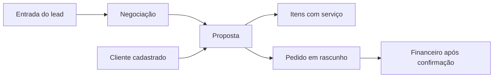

# Propostas comerciais: arquitetura de banco e backend

Status: banco, backend e frontend implementados em 13/10/2026. Contratos, decisões efetivas e validação em [PROPOSALS-IMPLEMENTATION.md](./PROPOSALS-IMPLEMENTATION.md).

## 1. Contrato funcional

- Selecionar um lead, uma negociação ou um cliente inicia **uma proposta nova**, preenchida com os dados conhecidos e o serviço de interesse da negociação. Propostas anteriores aparecem no histórico; a reutilização de seus preços e condições exige a ação explícita **Duplicar proposta**.
- Cada proposta pertence a uma empresa, a **uma negociação** e a **um cliente cadastrado** (`customers`). Um contato pode ter várias negociações e cada negociação pode ter várias propostas. A entrada do lead, inclusive por formulário, continua sem criar cliente; **salvar a primeira proposta** cria e vincula o cliente quando ele ainda não existe.
- A proposta salva contém **pelo menos um item** com `service_id` de `services`, inclusive quando está em rascunho. A descrição livre captada em formulário é uma sugestão de interesse, não substitui o serviço do catálogo. Uma proposta pode ter vários serviços.
- O botão **Novo serviço** ficará ao lado de **Serviço de interesse** na criação de lead e no seletor de itens da proposta. O modal reaproveita `POST /services` e seleciona o ID retornado. O formulário público não cadastra serviços automaticamente. O serviço criado continua no catálogo se o usuário cancelar o lead ou a proposta.
- Preço, quantidade e desconto negociados pertencem à proposta e não alteram o cadastro do serviço. Documento enviado preserva os dados como estavam no envio.
- Aceitar uma proposta não cria pedido. **Converter em pedido** é uma ação própria; usa o cliente ativo já vinculado à proposta. O pedido nasce como rascunho para revisão no Portal de Serviços. O financeiro começa somente quando esse pedido for confirmado pelas regras atuais.

## 2. Ponto de partida do repositório

| Existente | Consequência para o desenho |
| --- | --- |
| `crm_contacts.customer_id` é opcional; `crm_opportunities.primary_service_id` e `crm_lead_entries.primary_service_id` também | Lead e negociação podem chegar sem cliente ou serviço identificado; manter essa flexibilidade na captação e exigir cliente e serviço ao salvar a proposta |
| `customers` exige `kind` (`PF`/`PJ`) e `name`; documento é opcional e CPF/CNPJ informado é único por empresa | Pré-preencher o cadastro com dados do lead; pedir o tipo quando não for conhecido e impedir duplicação por documento |
| Cada oportunidade exige `origin_entry_id` | Uma proposta iniciada a partir de cliente sem negociação precisa criar contato, entrada manual e oportunidade no mesmo comando de criação |
| `services` já admite cadastro com apenas `name`, preço sugerido opcional e classificação fiscal opcional | Usar a API existente para o modal rápido; oferecer campos adicionais sem impedir o cadastro mínimo |
| `sales.customer_id` é obrigatório, pedido tem código de cinco dígitos, itens e parcelas separados | A proposta já fornece o cliente; conversão copia itens para um pedido `DRAFT` e deixa parcelas/OS/data da venda para revisão |
| `SalesService.create` prepara dados fora da transação e abre transação própria | A conversão precisa extrair um núcleo transacional reutilizável; chamar o método público dentro de outra transação deixaria risco de proposta e pedido divergirem |
| CRM usa `CrmPolicyService`, versionamento, chave de idempotência e `crm_activities` | Seguir esses padrões para permissões, concorrência e histórico |

## 3. Fluxos de entrada e cadastro rápido

### A partir de uma negociação

1. `GET /crm/proposals/prefill?opportunityId=...` valida acesso e devolve contato, cliente vinculado (se houver), serviço principal ativo, preço sugerido e descrição de interesse. Não grava nada.
2. Se o serviço principal não existir ou estiver inativo, apresentar busca do catálogo e **Novo serviço**. O texto livre recebido do formulário pode sugerir o nome do novo serviço, mas só um usuário autenticado o confirma.
3. `POST /services` cria o serviço na empresa ativa; o modal recebe seu ID e o seleciona. Na criação de lead, esse ID vai em `interest.primaryServiceId`; na proposta, vira `items[].serviceId`. Não é necessário alterar a oportunidade só porque foi incluído outro serviço na proposta; atualizar seu serviço principal é uma escolha explícita.
4. Antes de salvar, se o contato não tiver cliente vinculado, o backend prepara um cadastro de cliente com nome, e-mail, telefone e documento conhecidos do lead. CPF conhecido define `PF`; CNPJ conhecido define `PJ`. Se faltar tipo, o formulário pede `PF`/`PJ`; não o deduz pelo nome.
5. `POST /crm/proposals` bloqueia o contato `FOR UPDATE`, relê `customer_id`, valida pelo menos um item e grava **cliente (se necessário), vínculo no contato, proposta, itens, atividade e resultado idempotente na mesma transação**. O bloqueio evita dois cadastros ao salvar duas propostas simultaneamente para o mesmo lead; se falhar a proposta, não sobra um cliente criado por essa operação.

### Identidade e dados incompletos do lead

Um CPF/CNPJ normalizado que já exista na empresa leva à seleção/vinculação do cadastro existente após conferência de identidade; nunca se tenta criar outro cadastro com o mesmo documento. Sem documento, mostrar candidatos pelo nome/telefone/e-mail e permitir escolher um existente ou confirmar um novo; nomes iguais não autorizam junção automática. Se o lead já estiver vinculado a cliente inativo, pedir seleção de cliente ativo ou reativação antes de salvar. O cadastro rápido exige apenas os campos obrigatórios atuais (`kind`, `name`) e aceita dados complementares. A proposta não é gravada enquanto esses dados mínimos não estiverem disponíveis.

### A partir de um cliente já cadastrado

`GET /crm/proposals/prefill?customerId=...` devolve dados do cliente e negociações acessíveis vinculadas a ele. Se houver mais de uma negociação, o usuário escolhe uma. Se não houver nenhuma, ao salvar o backend cria ou reutiliza o contato CRM vinculado ao cliente, cria uma entrada `MANUAL` e o card inicial no funil padrão, junto com a proposta, numa transação. A mera abertura da tela não cria lead. O `POST` aceita **ou** `opportunityId` **ou** `customerId` com a opção `createOpportunity: true`; nunca aceita IDs conflitantes.

O sistema consulta contatos existentes vinculados ao cliente antes de criar outro. Havendo vários contatos possíveis, exige escolha explícita; não escolhe por semelhança de nome. A criação de contato/entrada/oportunidade deve reutilizar a lógica do `LeadCaptureService` em uma função que receba a transação atual, sem chamar a rota HTTP internamente.

### A partir de lead externo sem serviço cadastrado

Preservar `interestDescription`, origem, formulário e UTMs na entrada. O botão **Novo serviço** no cadastro manual de lead e na proposta usa o mesmo componente e a mesma API. Na proposta, o usuário escolhe ou cadastra pelo menos um serviço antes de salvar. Nenhum nome de produto vindo de formulário passa diretamente a `services` sem confirmação.

## 4. Modelo de dados PostgreSQL

Migração aditiva seguinte: `packages/database/drizzle/0018_crm_proposals.sql` (gerada pelo Drizzle, com ajuste SQL para a restrição diferida descrita abaixo). Declarar as tabelas em `packages/database/src/schema.ts` e gerar o snapshot correspondente. Não migrar os leads existentes: nenhuma coluna deles vira obrigatória.



| Tabela | Campos principais | Chaves e índices |
| --- | --- | --- |
| `crm_proposal_counters` | `company_id`, `next_number` | PK `company_id`; reserva transacional de número por empresa |
| `crm_proposals` | `id`, `company_id`, `proposal_number`, `contact_id`, `opportunity_id`, **`customer_id NOT NULL`**, `recipient_name`, `recipient_organization?`, `recipient_email?`, `recipient_tax_id?`, `replaces_proposal_id?`, `title`, `commercial_description?`, `payment_terms?`, `notes?`, `terms?`, `valid_until?` (`date`), `subtotal_amount`, `discount_amount`, `total_amount`, `status`, `version`, `issued_snapshot?` (`jsonb`), `issued_hash?`, `sent_at?`, `accepted_at?`, `declined_at?`, `decline_reason?`, `converted_at?`, `created_by_user_id`, `created_at`, `updated_at` | `UNIQUE(company_id,id)`, `UNIQUE(company_id,proposal_number)`, FK composta `(company_id,contact_id,opportunity_id)` para oportunidade e `(company_id,customer_id)` para cliente, FKs de ator e proposta substituída; índices `(company_id,created_at DESC,id DESC)`, `(company_id,opportunity_id,created_at DESC)`, `(company_id,customer_id,created_at DESC)`, `(company_id,status,valid_until)` |
| `crm_proposal_items` | `id`, `company_id`, `proposal_id`, `service_id`, `position`, `service_name_snapshot`, `description_snapshot?`, `unit_label_snapshot`, `quantity` `numeric(15,4)`, `unit_price` `numeric(15,2)`, `gross_amount`, `discount_type`, `discount_input`, `discount_amount`, `total_amount` | FK composta `(company_id,proposal_id)` e `(company_id,service_id)`; `UNIQUE(company_id,proposal_id,position)`; quantidades positivas, preço/desconto não negativos e desconto ≤ bruto |
| `crm_proposal_events` | `id`, `company_id`, `proposal_id`, `actor_type`, `actor_user_id?`, `event_type`, `before?`/`after?` `jsonb`, `reason?`, `recorded_at` | FK composta para proposta e ator; índice `(company_id,proposal_id,recorded_at,id)`; registro somente por inserção |
| `crm_proposal_commands` | `company_id`, `namespace`, `idempotency_key`, `request_hash`, `proposal_id?`, `sale_id?`, `result` `jsonb`, `created_at` | PK/única `(company_id,namespace,idempotency_key)`; replay somente do mesmo ator, escopo e hash canônico; resultado nunca expõe dados sem revalidar acesso |
| `sales` (adição) | `source_proposal_id?` | FK `(company_id,source_proposal_id)` para proposta e índice único parcial por empresa/proposta; impede dois pedidos da mesma proposta mesmo sob concorrência |
| `crm_activities` (adição) | `proposal_id?` e tipos `PROPOSAL_CREATED`, `PROPOSAL_UPDATED`, `PROPOSAL_SENT`, `PROPOSAL_ACCEPTED`, `PROPOSAL_DECLINED`, `PROPOSAL_CONVERTED` | FK composta `(company_id,contact_id,opportunity_id,proposal_id)` e índice da timeline; aponta para o evento causal, não duplica o documento inteiro |

O número legível será `P-000001` por empresa; `proposal_number` é um inteiro reservado com `INSERT ... ON CONFLICT ... RETURNING` na própria transação de criação. Esse número não substitui o UUID nas rotas.

**Integridade:** todas as relações entre empresas usam FKs compostas. A empresa de `crm_proposals.contact_id` deve coincidir com a oportunidade e a do cliente obrigatório. A gravação vincula `crm_contacts.customer_id` ao mesmo `customer_id`; a proposta retém esse ID e o retrato do destinatário mesmo se o contato for editado depois. Todo item aponta para serviço real do mesmo tenant. Criar/atualizar itens em lote numa única transação; uma `CONSTRAINT TRIGGER DEFERRABLE INITIALLY DEFERRED` verifica no commit que cada proposta tem pelo menos um item. O backend aplica a mesma validação antes de escrever para responder 422 com mensagem útil. Serviço deve estar `ACTIVE` no momento da seleção e do envio; inativação posterior não apaga o snapshot histórico.

**Valores:** `subtotal_amount = Σ gross_amount`, `discount_amount = Σ desconto`, `total_amount = subtotal - desconto`, calculados apenas no servidor. Reutilizar `sales-money.ts` e seus centavos em `bigint`: `gross = round(quantity × unit_price, 2)` por item. Aceitar desconto em reais **ou** porcentagem (0–100); guardar modo e valor informado, converter percentual em reais com arredondamento para centavo antes de somar. A conversão ao pedido copia o `discount_amount` calculado, pois o pedido atual trabalha com desconto em reais. Valores unitários negociados nunca modificam `services.suggested_unit_price`.

**Documento congelado:** enquanto `DRAFT`, cabeçalho e itens podem mudar com versão. Ao enviar, copiar para `issued_snapshot` canônico os dados do emissor, destinatário, itens, preço, condições, validade, moeda `BRL` e versão do modelo; gravar hash SHA-256 e evento. Esse JSON é imutável depois do envio e alimenta preview/PDF/conversão. Mudanças posteriores em contato, cliente, catálogo ou modelo de PDF não reescrevem a oferta enviada. Renegociação usa **Duplicar proposta**, com `replaces_proposal_id`, criando novo rascunho; conserva ambas as ofertas e evita editar proposta aceita ou enviada.

## 5. Estados e regras

```text
RASCUNHO --enviar--> ENVIADA --aceitar--> ACEITA --converter--> CONVERTIDA
                            \--recusar--> RECUSADA
                            \--validade ultrapassada--> VENCIDA (estado efetivo)
```

- Persistir `DRAFT`, `SENT`, `ACCEPTED`, `DECLINED`, `CONVERTED`. `EXPIRED` é calculado para proposta `SENT` cuja `valid_until` é anterior à data local da empresa; a validade inclui o dia indicado. Sem validade, não vence. Isso dispensa cron para manter o status correto; listas e filtros usam a mesma expressão SQL e devolvem `effectiveStatus`.
- Rascunho pode ser editado. Enviar exige serviço ativo, pelo menos um item, preço/quantidade válidos, `total_amount > 0`, destinatário e condições coerentes. A ação de enviar congela o documento e registra `sent_at`; criar rascunho não move a oportunidade para “proposta enviada”.
- Aceitar e recusar são comandos auditados apenas para `SENT` ainda válida. Uma proposta vencida precisa ser duplicada e reenviada; não volta a `SENT` por atualização de data. Recusa pode ter motivo e **não** marca automaticamente a oportunidade como perdida. Aceitação não marca a oportunidade como ganha.
- Apenas `ACCEPTED` converte. Uma proposta `CONVERTED` aponta para um pedido único. Pedido cancelado continua no histórico e mantém o vínculo; nova negociação comercial pede nova proposta explícita.
- Eventual automação de etapa “Proposta enviada” ocorre somente no comando enviar, se configurada. Automação de `WON` ocorre somente na conversão efetiva e se configurada. Ganho manual da oportunidade não cria pedido.

## 6. Backend e contratos HTTP

Criar `ProposalsController`, `ProposalsService` (comandos), `ProposalReadService`, `ProposalDocumentService` e esquemas Zod em `apps/api/src/crm`; registrar no `CrmModule`. Reusar `CrmPolicyService` para empresa, oportunidade, contato, serviço ativo e acesso do vendedor; estender a timeline do `CrmHistoryService`. Usar `AccessGuard`, `CompanyGuard`, `X-Company-Id` e Swagger como nas rotas atuais.

| Método e rota | Comportamento principal |
| --- | --- |
| `GET /crm/proposals/prefill?opportunityId=...` ou `?customerId=...` | Dados para nova proposta, negociações candidatas e serviço sugerido; sem gravar |
| `POST /crm/proposals` | Cria proposta nova com 1–100 itens e `Idempotency-Key`; recebe `opportunityId` ou `customerId + createOpportunity` e, se o lead não tiver cliente, `newCustomer` com os dados mínimos; cria/vincula cliente atomicamente; responde ID/número/status/totais/cliente |
| `GET /crm/proposals` | Busca por número, contato, cliente, negociação, responsável, serviço, status efetivo, período/validade; paginação e total, escopo por empresa |
| `GET /crm/proposals/:id` e `GET /crm/opportunities/:id/proposals` | Detalhes com itens, pedido vinculado e histórico autorizado |
| `PATCH /crm/proposals/:id` | Atualiza somente `DRAFT`, com `expectedVersion`; substituição de itens em lote, validação final e evento antes/depois |
| `POST /crm/proposals/:id/send` | Gera snapshot imutável e `SENT`, recebe `expectedVersion` e chave de idempotência; **não** envia WhatsApp/e-mail por si só |
| `POST /crm/proposals/:id/accept` / `decline` | Registra decisão, ator, instante e motivo opcional, com versão e chave |
| `POST /crm/proposals/:id/duplicate` | Nova proposta editável a partir do snapshot, mesmo contato/negociação; revalida serviços ativos e preços escolhidos |
| `POST /crm/proposals/:id/convert` | Cria pedido rascunho uma única vez usando `crm_proposals.customer_id`; devolve `saleId`/`orderCode` e URL de revisão |
| `GET /crm/proposals/:id/preview` / `pdf` | Renderiza exclusivamente o snapshot enviado; rascunho pode ter preview com marca d'água e sem link público |

`POST /services` permanece o contrato do modal rápido. O frontend busca `GET /services?status=ACTIVE&search=...`; após criar, adiciona o retorno ao seletor e mantém a seleção. Serviço sem preço sugerido exige preencher valor unitário na proposta. Ao escolher cliente/lead, não sobrescrever um rascunho que o usuário já editou.

Para compartilhar externamente mais tarde, criar token aleatório com hash no banco, vinculado a uma revisão congelada, expiração/revogação e endpoint público limitado ao PDF. A primeira entrega pode oferecer download do PDF e registro manual de envio; uma chamada `send` registra o estado comercial e não afirma que o documento foi entregue por um provedor. Se houver envio automatizado, usar outbox após commit e registrar confirmação/falha separadamente.

## 7. Conversão transacional para o Portal de Serviços

1. Validar ator e oportunidade, cliente ativo já ligado à proposta, versão, `ACCEPTED` e chave de idempotência. Se o contato tiver sido associado a outro cliente após o envio, bloquear conversão para evitar pedido com destinatário diferente; corrigir o vínculo ou emitir nova proposta intencionalmente.
2. Bloquear a proposta `FOR UPDATE` e consultar `sales.source_proposal_id`. Mesmo pedido já criado: revalidar acesso e devolver o mesmo resultado. Chave reaproveitada com payload distinto: `409`.
3. Em **uma transação PostgreSQL**, criar pedido `DRAFT` usando o snapshot aceito, inserir `sale_items`, `sale_status_history`, preencher `sales.source_proposal_id`, marcar proposta `CONVERTED`, registrar `crm_proposal_events`/`crm_activities` e, se configurado, marcar a oportunidade `WON`.
4. Gerar o código do pedido pela rotina atual, com retry de colisão da restrição `sales_company_order_code_uq`. Refatorar `SalesService.prepare` para aceitar o `tx` e extrair `createDraftInTx`; manter `SalesService.create` público usando esse mesmo núcleo. O retry precisa repetir **toda** a transação em colisão, nunca repetir só o `INSERT` do pedido.
5. Retornar o pedido rascunho ao Portal. Usuário complementa data da venda, formas de pagamento, parcelas, vencimentos e OS. `confirm` atual continua responsável por validar total/parcelas e criar financeiro. Condições comerciais textuais da proposta entram como observação de referência; não geram parcelas automaticamente.

O pedido copia o nome/descrição da oferta aceita. Para preservar o snapshot do serviço mesmo se o catálogo mudou, `createDraftInTx` deve aceitar itens já congelados da proposta e validar o vínculo original com `services`, sem substituir nome/descrição ofertados pelos dados atuais. Restrições de `sale_items` e totais continuam valendo. Quando a implementação optar por exigir serviço ainda ativo na conversão, deve comunicar isso antes e oferecer duplicar a proposta com serviço válido; a oferta aceita nunca é alterada silenciosamente.

## 8. Permissões, erros e observabilidade

- Gestor acessa as propostas da empresa. Colaborador acessa/cria/edita apenas nas negociações sob sua responsabilidade, aplicando `opportunityScope` também em listas, detalhes, PDF e replay idempotente. Alteração de responsável na oportunidade muda o acesso futuro, mas não a autoria histórica.
- `404` para IDs de outra empresa ou fora do escopo; `409` para versão obsoleta, documento de cliente já existente, comando repetido com corpo diferente, estado incompatível ou pedido já associado a outra conversão; `422` para item ausente, serviço inativo, desconto inválido ou dados mínimos de cliente ausentes ao criar a proposta. Erros têm códigos estáveis para o frontend (`PROPOSAL_SERVICE_REQUIRED`, `PROPOSAL_CUSTOMER_DETAILS_REQUIRED`, `PROPOSAL_CUSTOMER_CONFLICT`, `PROPOSAL_EXPIRED`, `PROPOSAL_VERSION_CONFLICT`, `PROPOSAL_ALREADY_CONVERTED`).
- Idempotência por empresa + comando + ator + chave, hash do payload normalizado, bloqueio/índice único. Revalidar permissão no replay; não devolver documento de um contato que o ator deixou de poder acessar.
- Eventos registram ator, campos alterados e valores antes/depois sem guardar segredos ou anexos. Logs técnicos incluem `companyId`, `proposalId`, `commandId`, `saleId` e duração, sem corpo de proposta/CPF. Metas: falhas de PDF, conflitos de conversão e pedidos duplicados (esperado zero).

## 9. Ordem de implementação e aceitação

1. Migração aditiva + esquema Drizzle + restrições de tenant, número e item obrigatório; aplicar antes de subir API nova.
2. Serviços de prefill, criação, edição, leitura, filtros, estados, eventos e timeline; reutilizar modal/API de serviço no frontend depois.
3. Snapshot de emissão, preview/PDF e duplicação, com template versionado.
4. Extração transacional de criação de pedido e conversão atômica; integrar a revisão no Portal de Serviços.
5. Testes de integração PostgreSQL: lead de formulário sem cliente/serviço; criação automática e vínculo de cliente na primeira proposta; duas propostas simultâneas do mesmo lead criam um só cliente; reuso por CPF/CNPJ sem duplicação; falta de PF/PJ; rollback do cliente quando proposta falha; criação rápida de serviço; várias propostas para mesma negociação; item obrigatório; fronteira de tenant; cálculo R$/%; snapshot após mudança de catálogo; vencimento na meia-noite do fuso da empresa; duas conversões simultâneas; colisão do código; rollback integral; replay idempotente; pedido em rascunho sem recebível até confirmação; permissão de PDF.

### Decisões registradas

| Decisão | Motivo e consequência |
| --- | --- |
| Proposta sempre ligada a uma negociação | Histórico e automações pertencem à negociação correta; selecionar só um cliente exige criar/selecionar oportunidade explicitamente |
| Cliente e serviço obrigatórios na proposta; opcionais no lead | Captar interessados com dados incompletos; formalizar o cadastro somente quando a primeira proposta é salva |
| Uma oferta enviada é imutável; renegociação duplica | PDF, aceitação e pedido mantêm a mesma base econômica, com histórico legível |
| `EXPIRED` derivado da data local | Status correto sem job de virada do dia; filtros precisam compartilhar a expressão |
| Conversão cria pedido `DRAFT` numa transação | Permite completar pagamentos/OS no Portal e evita venda/financeiro parcial sob falha ou clique repetido |
