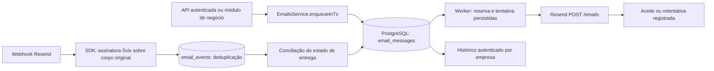

# Base de e-mails transacionais do GestãoNF

Status: implementada. Provedor: Resend. Data: 13/10/2026.

## Objetivo e contexto

Uma base reutilizável para as próximas funções de propostas, agenda, avisos e documentos. O sistema atual é um monólito modular NestJS/Fastify com PostgreSQL/Drizzle e um processo worker separado no Docker. Cada operação tem empresa e usuário autenticados. Nesta entrega, envio de texto com template, teste de conexão, histórico e acompanhamento de entrega estão implementados; o acionamento automático por cada módulo comercial será integrado quando suas regras forem definidas.

Não há domínio próprio nesta etapa. O remetente é `GestãoNF <onboarding@resend.dev>` e o destinatário real de teste é o e-mail da conta Resend, configurado por ambiente. O Resend restringe esse remetente ao proprietário da conta; oferece também destinatários de simulação para entrega, rejeição, reclamação e supressão. [Restrição de resend.dev](https://resend.com/docs/knowledge-base/403-error-resend-dev-domain), [testes](https://resend.com/docs/dashboard/emails/send-test-emails).

## Fluxo implementado

1. Validar usuário/empresa, formato e autorização da função. O endpoint direto exige OWNER, ADMIN ou MANAGER. O método interno `enqueueInTx` exige associação ativa; o módulo chamador continua responsável pelas permissões específicas de sua ação.
2. Reservar o envio na mesma transação da ação de negócio. Se a ação for desfeita, o e-mail também desaparece. Uma chave lógica por empresa identifica o evento; hash detecta reutilização com outro conteúdo. O criador também participa da validação de repetição.
3. Congelar destinatário, remetente, Reply-To, assunto, HTML e texto. Uma chave repetida nunca recria a mensagem nem usa conteúdo novo silenciosamente.
4. Worker reserva uma mensagem com lease de 60 segundos. A tentativa e sua possibilidade de ter chegado ao provedor são confirmadas no banco **antes** da requisição externa.
5. POST HTTPS para o endpoint fixo do Resend, timeout de 15 segundos e chave `gestaonf-email/{uuid}`. A resposta identifica o e-mail aceito; a entrega ainda depende dos eventos do provedor. [API de envio](https://resend.com/docs/api-reference/emails/send-email).
6. Webhook verifica assinatura/timestamp sobre o corpo original; grava metadados uma vez por `svix-id`. Não confia em `companyId` vindo do evento. A empresa é resolvida pelo e-mail previamente registrado. Eventos que precedem a resposta de envio ficam armazenados e são conciliados quando o ID externo fica conhecido. [Validação de webhooks](https://resend.com/docs/webhooks/verify-webhooks-requests).

## Banco de dados

| Tabela | Responsabilidade |
| --- | --- |
| `email_messages` | Outbox durável e histórico: empresa/autor, chave/hash, finalidade, conteúdo congelado, remetente/destinatário, modo de teste, tentativas, próxima execução, lease, ID do provedor e estados |
| `email_events` | Metadados dos eventos assinados: ID Svix único, ID do e-mail Resend, tipo, data do evento e de recebimento |

FK composta garante que o autor pertence à empresa. Chave lógica é única por empresa; ID Resend é único globalmente. Índices atendem fila, cronologia por empresa, destinatários e correlação de eventos. A tabela de eventos admite registro sem relação local conhecida porque o webhook pode chegar antes da resposta do POST.

O histórico público apresenta status, destinatário, assunto e datas. Corpo, credenciais, hash/chave interna e informações de lease não são expostos. Gestores veem o histórico da empresa; colaboradores veem apenas mensagens criadas por eles por meio das funções autorizadas que usem esta base.

## Estados e recuperação

Envio: `QUEUED → SENDING → ACCEPTED`, ou `SENDING → RETRYING → SENDING`. Falhas definitivas viram `FAILED`; resultados potencialmente aceitos sem confirmação segura viram `UNKNOWN`. Um worker interrompido deixa lease recuperável, usando o mesmo payload e a mesma chave.

Entrega: `PENDING`, `SENT`, `DELAYED`, `DELIVERED`, `FAILED`, `SUPPRESSED`, `BOUNCED`, `COMPLAINED`. Aceite HTTP não significa recebimento. A projeção usa prioridade: reclamação e rejeição prevalecem; entrega comprovada prevalece sobre atraso/aceite. Eventos atrasados não fazem um e-mail entregue voltar a enviado. `DELIVERED` significa aceite do servidor destinatário; não prova leitura. [Tipos de eventos](https://resend.com/docs/webhooks/event-types).

Retentativas: até 8 tentativas, espera exponencial e respeito a `Retry-After`. Falhas de rede/5xx e concorrência de chave são retentadas; erros de autenticação, domínio, payload ou cota mensal são encerrados. Cota diária aguarda a próxima virada UTC quando houver janela segura. [Erros](https://resend.com/docs/api-reference/errors), [limites e cabeçalhos](https://resend.com/docs/api-reference/rate-limit).

O Resend mantém idempotência por 24 horas. A aplicação limita novas tentativas a 23 horas desde a primeira tentativa persistida, inclusive após reinício. Depois disso, um resultado ambíguo fica em UNKNOWN e exige conciliação operacional no painel, sem novo envio automático. Isso evita prometer entrega exatamente uma vez além da garantia disponível. [Idempotência](https://resend.com/docs/dashboard/emails/idempotency-keys).

Se a primeira tentativa foi definitivamente recusada e não houve tentativa ambígua, o encerramento é FAILED. Se houver aceitação seguida de perda de conexão/banco, a recuperação usa a chave original. Eventos órfãos de um envio cujo ID nunca foi conhecido ficam retidos para diagnóstico; esta versão não faz consulta automática ao painel para reconciliar UNKNOWN.

## Decisões de arquitetura

### ADR: outbox no PostgreSQL consumida pelo worker existente

Alternativas: envio síncrono dentro do HTTP; publicar direto no Redis; outbox + dispatcher BullMQ; outbox especializada consumida no banco.

Escolhida: `email_messages` como outbox com consumidor no worker atual. Os lembretes e limpeza de arquivos já seguem consumo periódico de dados persistidos. Evita perda entre commit e publicação e mantém uma única representação da tentativa; não adiciona cópia dos corpos no Redis. O dispatcher WhatsApp continua consumindo seus próprios tópicos.

Trade-off: polling de um segundo e consultas ao banco. Aceito para a fase inicial; o consumo não bloqueia uma transação durante o HTTP. `SKIP LOCKED`, lease e lock global curto na reserva coordenam workers concorrentes. Novas reservas respeitam um segundo entre tentativas globais. Revisitar com volume sustentado alto ou necessidade de maior throughput; preservar outbox/IDs e transferir execução para BullMQ.

### ADR: REST para envio e SDK oficial para assinatura

A API REST fixa usa `fetch` nativo, preserva status HTTP e headers de retentativa e evita registros automáticos de erros brutos do SDK. O SDK oficial Resend verifica o padrão Svix, incluindo assinatura e timestamp. Nenhuma implementação própria de criptografia de webhook foi adicionada. A API key fica apenas no servidor/worker.

Trade-off: validar manualmente respostas REST e classificar erros. Os testes cobrem payload/chave, falha transitória/permanente e assinatura real do SDK. Revisitar se o SDK oferecer controle equivalente de logs e transporte.

### ADR: template local e testes restritos

Um template local gera HTML com escape de todo texto dinâmico e versão textual. O endpoint aceita texto simples, não HTML arbitrário. Um destinatário por mensagem facilita estados, cotas e rejeições. Remetente e Reply-To vêm de configuração, não de parâmetros do navegador.

O modo de teste recusa destinatários externos em vez de redirecionar conteúdos de clientes. Ao trocar modo/remetente, mensagens antigas pendentes param com `configuration_changed` para preservar o conteúdo assinado e impedir emissão acidental. Não se altera uma mensagem congelada para retentar.

## Extensões previstas

- Propostas: gerar/congelar revisão e conteúdo; enfileirar com chave baseada no evento/revisão; manter estado comercial separado da entrega pelo provedor.
- Agenda: regras específicas escolherão destinatários e momento; a ocorrência de lembrete fornece a chave lógica.
- Anexos R2: uma futura função deverá autorizar empresa/arquivo, congelar o documento e considerar o limite de tamanho do Resend. Não usar URLs de download de 120 segundos em mensagens destinadas à leitura posterior. Esta entrega envia texto/HTML; não vincula automaticamente anexos da venda a e-mails.
- Domínio: verificar registros DNS indicados pelo Resend e mudar remetente/mode por ambiente. Configuração compartilhada do GestãoNF nesta fase; domínios individuais de empresas exigirão um fluxo próprio.
- Campanhas de marketing, listas e descadastro exigem regras próprias e não são acionadas por esta base transacional.

## Configuração e validação

Consulte [README.md](./README.md) para ativação, contrato HTTP e teste real. Migration `0020_woozy_scorpion.sql`. Testes usam banco PostgreSQL isolado, transporte substituído e assinaturas Svix verificadas pelo SDK oficial; não enviam e-mails aos clientes. A confirmação de entrega real depende da API key e do webhook configurados pelo operador.
