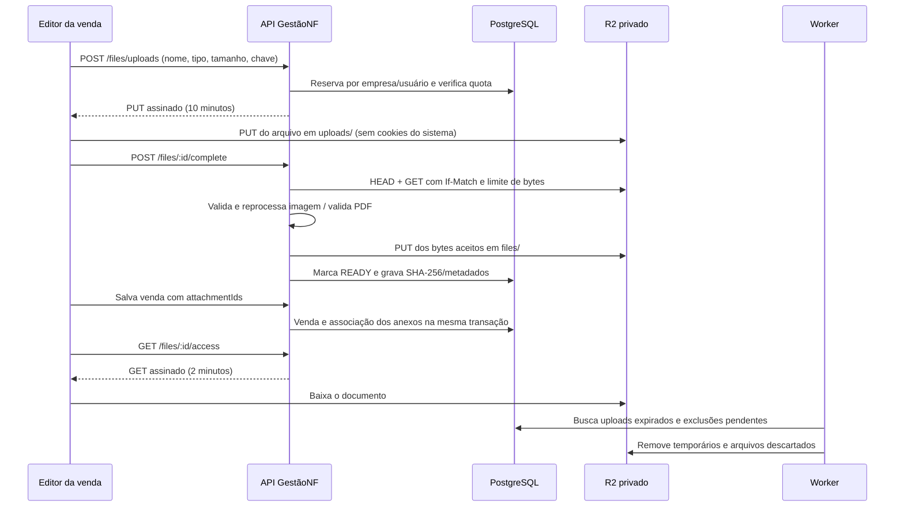

# Arquivos privados de vendas — Cloudflare R2

Decisão aceita em 13/10/2026. Implementação: NestJS/Fastify, PostgreSQL/Drizzle, worker existente e React. Primeiro uso: contratos e anexos da venda de serviços. Botão de seleção de arquivo ao lado de **Total da venda**, sem modal; cada anexo oferece download e remoção ao salvar. Formatos: PNG, JPEG e PDF.

## Fluxo e fronteiras

Empresa e usuário são obtidos de autenticação e `X-Company-Id`; nunca do corpo de upload. O bucket, as chaves dos objetos e as credenciais são definidos no servidor. O cliente recebe URLs temporárias, e o banco guarda os identificadores persistentes, nunca URLs assinadas.

`uploads/{companyId}/{fileId}/{nonce}` é uma chave temporária. `files/{companyId}/{fileId}/original.{ext}` contém os bytes verificados. URLs de PUT são reutilizáveis até vencerem, portanto um upload posterior na chave temporária nunca altera o documento aceito. A limpeza dos temporários só é considerada concluída depois do vencimento da URL mais um minuto de tolerância. Uma regra R2 de expiração de `uploads/` em um dia é uma segunda proteção contra temporários órfãos.

## Decisões e alternativas

| Decisão | Motivo | Custo/limitação aceita |
| --- | --- | --- |
| R2 privado e S3 SDK | Armazena imagens e documentos no mesmo bucket; cabe no backend existente | Não oferece sozinho transformação de imagens ou antivírus |
| PUT direto temporário, seguido de verificação no backend | Progresso no navegador; credenciais ficam no servidor | CORS obrigatório no bucket; backend lê arquivo na verificação |
| Chave definitiva diferente da temporária | Evita alteração de arquivo aceito reutilizando PUT | Uma gravação e um temporário adicionais |
| PNG/JPEG até 10 MiB; PDF até 25 MiB; 10 anexos/venda | Upload simples atende contratos e fotos sem multipart | Arquivos grandes, GIF, WEBP e SVG não são aceitos nesta etapa |
| Imagens decodificadas/regravadas com Sharp | Confere conteúdo e remove EXIF/GPS e dados extras | Os bytes e o tamanho da imagem podem mudar; 40 milhões de pixels e imagem estática |
| PDFs validados com pdf-lib e preservados integralmente | Preserva assinatura digital e documento original | PDF protegido por senha ou sem páginas é recusado; limite de 2.000 páginas; validação não é antivírus |
| PDFs servidos como attachment | Abre o download do documento original | Sem visualizador embutido nesta entrega |
| Estado/lock por arquivo no PostgreSQL | Finalizar duas vezes produz o mesmo resultado; limpeza não compete com associação | Durante a verificação, a transação mantém um lock do arquivo e uma conexão; requisições R2 têm timeout e tamanho limitado |
| Remoção lógica imediata, limpeza pelo worker | Não perde exclusão em falha/reinício; repetição segura | Um link de GET já emitido pode permanecer utilizável até 2 minutos |

Reavaliar multipart, processamento em fila, CDN/Cloudflare Images e antivírus quando surgirem arquivos maiores, exigência de visualização pública, volume de finalizações concorrentes ou necessidade de inspeção especializada.

## Dados e autorização

Migration `0019_private_files.sql` cria `stored_files`: empresa, autor, venda opcional, nome normalizado, MIME, bytes esperados/reais, hash SHA-256, dimensões/páginas, bucket, chaves interna/definitiva, estados e timestamps de expiração/limpeza. A FK composta `(company_id,sale_id)` impede associação entre empresas. Índices atendem idempotência, venda, paginação e limpeza.

Estados: `PENDING` → `READY` ou `REJECTED`; expiração gera `EXPIRED`; remoção gera `DELETING` → `DELETED`. Arquivos `READY` ainda sem venda expiram em 24 horas, atendendo cancelamento/abandono do editor. Arquivos associados à venda permanecem; cancelar a venda não apaga contratos.

Antes de associar, conferir `READY`, prazo, empresa, autor/gestor e venda anterior. Arquivo não é compartilhado entre dois pedidos. A associação e a remoção usam locks em ordem de ID na transação do pedido. O campo `attachmentIds` é opcional para manter os clientes anteriores: ausente preserva anexos, `[]` remove todos; array aceita até 10 IDs únicos. Falha de gravação da venda desfaz os vínculos e deixa o upload disponível para nova tentativa até seu vencimento.

Upload sem venda: autor e OWNER/ADMIN/MANAGER da empresa acessam. Associado: membros ativos da empresa acessam, acompanhando a política atual de leitura da venda. Todos os caminhos de download revalidam empresa, usuário e vínculo ativos. Ao remover, não se emitem novas URLs de acesso. Novos domínios ou novos módulos devem usar os IDs dos arquivos e autorização de domínio, sem copiar chaves ou URLs persistentes.

## Quotas e operação

Quota inicial configurável de 1 GiB por empresa. A reserva serializada inclui cópia temporária e reserva definitiva (10 MiB para normalização de imagem, tamanho declarado para PDF); quotas não têm saldo negativo em uploads concorrentes. Até 20 uploads com URL ainda na janela de limpeza por usuário/empresa. Nome é tratado apenas como metadado; chave é UUID gerado pelo servidor.

PUT assina Content-Type, Content-Length e Cache-Control. HEAD e GET ainda verificam MIME e quantidade de bytes, pois metadados isolados não validam conteúdo. If-Match evita ler uma versão diferente da observada. SDK utiliza `requestChecksumCalculation/responseChecksumValidation = WHEN_REQUIRED` por compatibilidade R2 e não depende de ACLs S3 ou recursos inexistentes.

O worker verifica a limpeza a cada minuto, seleciona arquivos com `SKIP LOCKED`, e mantém a exclusão pendente se R2 falhar. Falha após PUT definitivo e antes do commit deixa a reserva pendente: limpeza remove ambas as chaves após expiração. Registros tombstone permanecem; exclusão de bytes não remove histórico técnico. Logs registram tipo de erro e ID, sem credenciais, conteúdo de contrato ou URL assinada.

## Referências oficiais pesquisadas

- [R2 S3, bucket e credenciais](https://developers.cloudflare.com/r2/get-started/s3/)
- [URLs assinadas, expiração e reutilização](https://developers.cloudflare.com/r2/api/s3/presigned-urls/)
- [CORS para uploads pelo navegador](https://developers.cloudflare.com/r2/buckets/cors/)
- [Compatibilidade e limites da API S3](https://developers.cloudflare.com/r2/api/s3/api/)
- [SDK AWS JavaScript v3](https://developers.cloudflare.com/r2/examples/aws/aws-sdk-js-v3/)
- [Regras de expiração de objetos](https://developers.cloudflare.com/r2/buckets/object-lifecycles/)
- [Autenticação R2](https://developers.cloudflare.com/r2/api/tokens/)
- [Sharp: limite de pixels e validação](https://sharp.pixelplumbing.com/api-constructor/)
- [pdf-lib: carregamento de PDFs](https://pdf-lib.js.org/docs/api/classes/pdfdocument#load)
