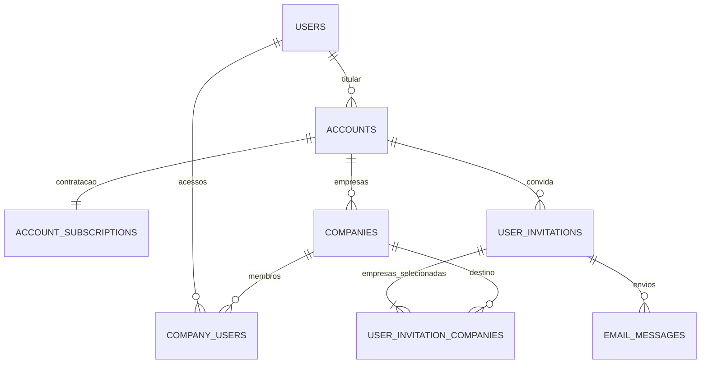

# Usuários convidados, empresas e assinatura — arquitetura

Status: banco, backend, tela de usuários e página de aceite implementados.
Data: 13/10/2026. Stack: NestJS/Fastify, PostgreSQL/Drizzle, autenticação existente, outbox de e-mail e Resend.

## 1. Requisitos e decisões confirmadas

- O contratante é o titular administrador da sua conta de contratação. Seu acesso às próprias empresas usa o papel técnico `OWNER`, já existente.
- **Cada empresa tem cinco usuários adicionais incluídos**, além do titular. O mesmo usuário em duas empresas ocupa uma vaga em cada empresa.
- Um convite pode selecionar várias empresas por checkbox, todas pertencentes à conta administrada pelo titular.
- O formulário pede nome, e-mail e empresas. Não pede senha ou CPF.
- A solicitação cria um convite e um envio de e-mail. Não cria `users`, credenciais ou acesso antes do aceite.
- Quem não possui conta define sua senha no aceite. Quem já possui conta entra com seu próprio e-mail e senha e confirma o vínculo.
- O gerenciamento detalhado de permissões ficará para a próxima etapa. A base preserva os papéis técnicos existentes e aplica isolamento por empresa; não acrescenta editor de permissões nem promoção de convidados.
- Envio por Resend sem webhook nesta fase. O convite pode ser aceito independentemente de existir evento de entrega.

Regra confirmada pelo usuário: convite válido por 24 horas; convite pendente reserva as vagas necessárias; cancelamento ou expiração libera as reservas. Depois do aceite, o acesso permanece até ser removido pelo administrador. Reenvio gera um novo token com validade de 24 horas a partir do reenvio, mantendo uma única reserva.

## 2. O que já existe e o que precisa mudar

| Componente atual | Evidência no código | Uso previsto |
| --- | --- | --- |
| Identidade global por e-mail único normalizado | `packages/database/src/schema.ts`: `users` | Reutilizar, sem criar um usuário por empresa |
| Senha derivada por scrypt | `apps/api/src/auth/auth.service.ts` | Reutilizar política e algoritmo; nunca substituir a senha de uma conta existente durante convite |
| Login, refresh e cookies | `auth.service.ts`, `auth.controller.ts` | Reutilizar sessão global do usuário |
| Vínculo e papel por empresa | `company_users`, `CompaniesService` | Criar/reativar vínculos somente no aceite; preservar vínculos de outras empresas |
| Verificação de empresa em requisições | `CompanyGuard` | Acrescentar disponibilidade da conta/plano e reutilizar a política também em workers e Nero |
| Empresas criadas com OWNER | `CompaniesService.create` | Associar a empresa à conta contratante e validar quem pode criá-la |
| Fila de e-mails transacional | `EmailsService.enqueueInTx`, `EmailDispatchService` | Adaptar para template de convite com botão, correlação, cancelamento e payload sensível |

Não existe hoje módulo de assinatura, pagamento, limite de usuários ou convite. O cadastro atual autentica o usuário imediatamente, e a criação de empresa atribui OWNER sem verificar plano. Essas rotas precisarão da política de contratação; a identidade do usuário e seus vínculos comerciais são conceitos separados.

## 3. Organização da contratação e acesso



`accounts` representa a contratação do titular, que pode possuir várias empresas. O limite é aplicado individualmente a cada uma dessas empresas. `users` continua global: a mesma pessoa pode ser titular em uma contratação e convidada em outras.

`company_users` permanece a fonte do acesso empresarial. Não é necessário criar outra tabela de membros da contratação nesta base: isso duplicaria os vínculos atuais. O titular administra sua contratação; o convidado conhece apenas as empresas às quais foi vinculado.

### Titular e pagamento

1. Cadastro cria a identidade e a senha pelo fluxo atual.
2. Endpoint autenticado de abertura de contratação cria `accounts` e assinatura `PENDING`, usando o usuário da sessão como titular.
3. Quando a cobrança for implementada, um evento confiável do provedor ou operação interna autorizada ativa a assinatura e seus benefícios.
4. O titular cadastra empresas da contratação e recebe vínculo OWNER nelas. Colaboradores não criam empresa nessa contratação.

O navegador não pode definir `ownerUserId`, marcar pagamento como aprovado ou editar cotas. A conta tem um titular desde a criação; a confirmação do pagamento habilita o uso contratado. A atribuição de administrador é contextual à sua própria contratação, sem conferir administração geral do GestãoNF.

Como o provedor de cobrança ainda não foi escolhido, esta funcionalidade define a fronteira interna de ativação e as cotas. Não pressupõe que pagamento já esteja integrado. Ambiente local pode receber ativação `LEGACY_DEV`, auditada e apenas por rotina interna de desenvolvimento.

## 4. Banco de dados proposto

### `accounts` — nova

- `id UUID PK`, `owner_user_id FK users`, `name`, `status`, `created_at`, `updated_at`.
- Estados: `PENDING`, `ACTIVE`, `SUSPENDED`, `CANCELED`.
- Na primeira implementação, impedir duas contratações PENDING/ACTIVE idênticas para o mesmo titular por duplo clique usando idempotência; não inferir nova contratação no login ou no aceite de convite.
- Uma conta possui exatamente um titular. Não impor unicidade global de `owner_user_id`: uma pessoa poderá contratar outra conta independente no futuro.
- Índice de consulta por titular e status. Titular não é removível pelo cadastro de usuários.

### `account_subscriptions` — nova, estado comercial interno

- `account_id PK/FK accounts`, `plan_code`, `status`, `additional_users_per_company`, `current_period_ends_at`, `source`, `version`, timestamps.
- Benefício inicial: `additional_users_per_company = 5`; titular excluído da contagem.
- Estados: `PENDING`, `ACTIVE`, `SUSPENDED`, `CANCELED`. Benefício sem prazo somente para fonte interna de desenvolvimento; assinaturas reais precisam de validade e renovação confiável.
- A política de acesso considera conta, status da assinatura e prazo. Não calcula aprovação de pagamento a partir de parâmetros públicos.
- API pública não altera limite, fonte ou status. Mudanças internas são auditadas com identificador idempotente do evento.
- A implementação da cobrança definirá o histórico financeiro e a conciliação do provedor; não se criam dados de cobrança fictícios nesta fase.

### `companies` — alteração

- Adicionar `account_id NOT NULL FK accounts`, após migração gradual.
- Criar `UNIQUE(account_id, id)` para referências compostas dos convites.
- Uma empresa pertence a uma contratação. A troca de proprietário/contratação exigirá fluxo futuro explícito.

### `users` — alteração pequena

- Preservar e-mail único normalizado e nome global.
- Adicionar `email_verified_at NULL`. No aceite válido, preencher como prova de controle do e-mail convidado; não marcar todos os usuários legados como verificados.
- Esta entrega não cria um novo fluxo geral de verificação de cadastro, troca de e-mail ou recuperação de senha. A coluna permitirá esses fluxos posteriormente.

### `company_users` — preservar e complementar

- PK `(company_id, user_id)` e histórico de referências permanecem.
- Adicionar `updated_at`, `joined_via_invitation_id NULL`, `version` para alterações concorrentes/auditoria.
- `status` continua `ACTIVE/INACTIVE`. Desativar preserva o registro para não quebrar FKs de vendas, propostas, reuniões, arquivos e mensagens.
- `joined_via_invitation_id`, quando presente, deve referenciar `(invitation_id, company_id)` de `user_invitation_companies`, impedindo registrar origem incompatível.
- O titular mantém OWNER. Convites novos usam o papel técnico existente `COLLABORATOR` como valor base, sem seleção no formulário. O catálogo detalhado de permissões será definido na próxima fase.

### `user_invitations` — nova

- `id UUID PK`, `account_id`, `invited_name`, `email_normalized`, `created_by_user_id`, `token_hash CHAR(64)`, `status`, `expires_at`, `accepted_by_user_id NULL`, `accepted_at NULL`, `revoked_at NULL`, `version`, `last_sent_at NULL`, timestamps.
- `UNIQUE(account_id, id)` para referências compostas e `UNIQUE(token_hash)`.
- Índice único parcial `(account_id, email_normalized) WHERE status='PENDING'`.
- Índices por contratação/status/data e status/expiração.
- Estados: `PENDING`, `ACCEPTED`, `REVOKED`, `EXPIRED`. Aceite exige usuário/data; revogação exige data.
- Nome pertence ao convite; só inicializa `users.name` quando a identidade é nova. Convite não altera nome/senha de uma conta que já existe.
- E-mail não pode ser alterado em um convite existente. Cancelar e emitir um novo preserva a auditoria.
- Normalização: trim/lowercase antes de validar; não remover pontos ou `+` de endereços Gmail.

### `user_invitation_companies` — nova

- `invitation_id`, `account_id`, `company_id`, `created_at`; PK `(invitation_id, company_id)`.
- FK composta `(account_id, invitation_id)` para o convite.
- FK composta `(account_id, company_id)` para a empresa.
- Índice `(company_id, invitation_id)` para calcular reservas.
- Pelo menos uma empresa por convite, validada no serviço transacional. Todas precisam pertencer à mesma contratação e estar ativas.
- Sem controle individual de permissões nesta tabela por enquanto.

### `user_management_commands` — nova, pequena tabela de idempotência

- `id`, `account_id`, `actor_user_id`, `request_key`, `request_hash`, `operation`, `invitation_id NULL`, `result_user_id NULL`, `created_at`.
- Único `(account_id, actor_user_id, request_key)`; hash valida o payload normalizado.
- FK composta de convite com account_id; actor/result_user referenciam users. Esta tabela atende comandos administrativos autenticados. Aceite público é consumido sob lock do token/convite, sem inventar um actor antes de criar a identidade.
- Garante que repetição de criar/reenviar/alterar vínculos não gere um segundo convite ou e-mail. Chave repetida com outro payload retorna 409.

### `user_management_events` — nova, auditoria

- `id`, `account_id`, `actor_user_id NULL`, `target_user_id NULL`, `invitation_id NULL`, `company_id NULL`, `event_type`, `changes JSONB`, `created_at`.
- Índices por contratação/data, convite/data e empresa/usuário.
- FKs compostas mantêm convite/empresa na contratação do evento; actor/target referenciam users globais. Eventos de sistema podem ter actor NULL.
- Registrar criação, reenvio, aceite, revogação, expiração e adição/remoção de vínculo.
- `changes` contém IDs, estados e diferença de empresas. Nunca senha, token, hash de senha, corpo de e-mail ou segredo de API.

### `email_messages` — complementos necessários

- `invitation_id NULL FK`, `invitation_version NULL` e estado `CANCELED`.
- Payload sensível criptografado opcional, com identificador de chave, para o HTML/texto do convite. Colunas de corpo deverão permitir NULL com CHECK: mensagens em fila têm conteúdo comum ou conteúdo criptografado; mensagens terminais podem ter conteúdo descartado.
- Configuração proposta: `EMAIL_PAYLOAD_ENCRYPTION_KEY` em Base64 de 32 bytes e `EMAIL_PAYLOAD_ENCRYPTION_KEY_ID=v1`, geradas localmente na implementação e compartilhadas por API/worker. Convites ficam indisponíveis quando a proteção não está configurada; envios comuns continuam com o contrato atual.
- Remetente/destinatário/assunto e metadados ficam pesquisáveis; o link secreto não fica nos corpos comuns ou respostas de histórico.
- Convite e e-mail são gravados na mesma transação. Cada versão do convite tem um envio lógico `user-invitation/{id}/{version}`; a chave enviada ao Resend continua vinculada ao UUID do e-mail.

## 5. Vagas por empresa

Para cada empresa selecionada:

```text
limite = assinatura.additional_users_per_company              # inicialmente 5
ocupadas = vínculos ACTIVE cujo user_id não é o titular
reservadas = e-mails distintos de convites PENDING não expirados
             destinados à empresa, sem vínculo ACTIVE desse e-mail na empresa
disponíveis = max(0, limite - ocupadas - reservadas)
```

Não usar um campo contador incrementado sem reconciliação. A contagem vem de vínculos e convites persistidos e é feita sob lock para admissão. Mudanças da cota e do estado da assinatura usam a mesma coordenação.

| Situação | Empresa A | Empresa B |
| --- | --- | --- |
| Titular | Não ocupa vaga adicional | Não ocupa vaga adicional |
| Ana recebe acesso a A e B | Ocupa uma vaga | Ocupa uma vaga |
| Ana continua em A e recebe acesso adicional a B | Nenhuma vaga nova | Uma vaga nova |
| Convite pendente para Bruno em A | Reserva uma vaga | Nenhuma |
| Bruno aceita o convite | Reserva vira vínculo; total igual | Nenhuma |
| Bruno é desativado em A | Libera uma vaga | Vínculos de B permanecem |

Se uma das empresas estiver sem vaga, toda a emissão do convite falha com 409 `COMPANY_USER_LIMIT_REACHED`, identificando as empresas indisponíveis. Não enviar convite concedendo só parte das empresas pedidas silenciosamente.

Limite adicional conta qualquer usuário diferente do titular, independentemente do papel técnico. Promover para ADMIN no futuro não transforma o colaborador em uma vaga gratuita extra. Cadastrar uma segunda contratação ocupa outra cota apenas se criar vínculo naquela empresa; não há contagem global por usuário.

### Concorrência e ordem de locks

- Abrir transação e bloquear linha da contratação/assinatura para serializar alterações de contratação, convites e vínculos desta conta pequena.
- Bloquear empresas envolvidas em ordem crescente de UUID; depois convite/comando/vínculos necessários. Manter a mesma ordem em emissão, aceite, reenvio, revogação e desativação.
- Expirar logicamente convites antigos antes de conferir índice parcial; nas contagens, sempre excluir por `expires_at <= now()`, mesmo se o job ainda não rodou.
- Recalcular ocupadas/reservadas sob lock e somente depois escrever novos registros.
- No aceite, excluir o próprio convite da contagem de reservas e simular os vínculos resultantes. O aceite troca a reserva por acesso sem exigir uma segunda vaga.
- Se a cota foi reduzida ou empresas foram suspensas depois da emissão, não aceitar parcialmente: retornar conflito e manter o convite pendente até expirar/cancelar.
- Migração legada com excesso de usuários não remove pessoas automaticamente. Exibir excesso, bloquear novos acréscimos e permitir redução de vínculos.

## 6. Fluxo de criação e e-mail

```mermaid
sequenceDiagram
  actor Admin as Titular
  participant API as UserManagementService
  participant DB as PostgreSQL
  participant Worker as Worker de e-mail
  participant R as Resend
  actor Guest as Convidado
  Admin->>API: Nome, e-mail, empresas + Idempotency-Key
  API->>DB: Autorizar, conferir vagas, salvar convite + e-mail
  DB-->>API: Commit
  API-->>Admin: 202 convite pendente; nenhum acesso criado
  Worker->>DB: Validar versão/estado e reservar envio
  Worker->>R: Enviar link de aceite
  R-->>Worker: Aceite do envio ou falha
  Guest->>API: Validar token e aceitar com senha nova ou login existente
  API->>DB: Consumir token, criar identidade se necessária e vínculos
  DB-->>API: Commit atômico
  API-->>Guest: Sessão/empresas autorizadas
```

O servidor verifica titular, assinatura habilitada, empresas ativas e limite. Se houver convite pendente para o e-mail na contratação, retorna conflito e permite reenvio/edição das empresas pelo registro existente. Se a pessoa já acessa todas as empresas selecionadas, orienta editar o cadastro, sem emitir convite redundante. Se acessa apenas parte, o convite pode incluir as empresas selecionadas e reservar apenas os novos acessos.

POST retorna 202 com ID, status `PENDING`, expiração, empresas e estado de envio separado. O rótulo não afirma entrega. Falha transitória gera retentativa pela base de e-mails; falha definitiva mantém a solicitação visível e as reservas até cancelamento ou expiração. A resposta não apresenta o token para o administrador nem informa se esse e-mail tem uma conta global em outras contratações.

Template: nome do titular/contratação, empresas selecionadas, prazo e botão **Aceitar convite**. Texto alternativo também contém o link. A URL vem de `WEB_ORIGIN` validado, não do header Host nem de parâmetro enviado pelo navegador.

## 7. Token, expiração e proteção do link

- Token aleatório com `randomBytes(32).toString('base64url')`, com hash SHA-256 no convite.
- A página `/aceitar-convite#token=...` usa o fragmento para evitar que o token apareça na URL recebida pelo servidor web. A página envia o token no corpo do POST de preview/aceite; não usar token em paths de API nem registrar request bodies dessas rotas.
- Hash protege a tabela de convites. Como o e-mail também contém o link, o corpo sensível da outbox deverá ser criptografado por AES-256-GCM com nonce aleatório e chave de ambiente gerada na implementação. Não afirmar que o banco guarda só hash enquanto houver link em texto na fila.
- Descriptografar somente para o envio e conservar o mesmo conteúdo para retentativas idempotentes. Ao confirmar ACCEPTED, descartar o payload sensível no mesmo commit. Falhas/cancelamentos expurgam o payload após invalidar o token ou atingir sua expiração.
- GET da página e POST de preview não consomem convite; scanners de segurança do e-mail não podem aceitar automaticamente.
- Token é de uso único, expira em 24 horas e fica inválido ao cancelar ou reenviar. Vínculos empresariais aceitos não expiram com o token.
- Página de aceite: `Cache-Control: no-store`, `Referrer-Policy: no-referrer`, sem scripts/recursos de terceiros. HTTPS em ambiente externo; localhost permitido apenas para desenvolvimento no mesmo computador.
- Rate limit público por IP e identificador do token; respostas de token inexistente/expirado/revogado não revelam contas por consulta livre de e-mail. Não bloquear a conta de um usuário por tentativas de token inválido.

A política de token segue propriedades de links de autenticação indicadas pela [OWASP](https://cheatsheetseries.owasp.org/cheatsheets/Forgot_Password_Cheat_Sheet.html). A validade de 24 horas foi definida pelo usuário; a escolha de fragmento e criptografia da outbox são decisões desta arquitetura.

## 8. Aceite com e sem conta existente

### Preview

`POST /user-invitations/preview { token }` apresenta, somente para quem possui token válido, nome da contratação, empresas, e-mail mascarado e próximo passo `DEFINE_PASSWORD` ou `LOGIN`. Não retorna ID global do usuário, senha, dados de outras empresas ou e-mail livremente pesquisável.

### Nova identidade

`POST /user-invitations/accept-new { token, password, passwordConfirmation }`:

1. Validar senha com a política atual: 12–128 caracteres; igualdade de confirmação.
2. Calcular scrypt fora da transação longa, depois revalidar convite/cota/estado em transação.
3. E-mail é sempre o do convite, nunca um e-mail enviado no body. Reconsultar `users` para tratar cadastro concorrente.
4. Se uma conta com esse e-mail apareceu, retornar `LOGIN_REQUIRED`; não escrever credencial por cima nem redefinir senha.
5. Criar `users`, `user_credentials`, vínculos das empresas selecionadas, auditoria, consumo do convite e sessão numa operação atômica.
6. Emitir cookies via mecanismo já usado no cadastro. Novo convidado recebe apenas as empresas selecionadas; não se cria contratação nem empresa em seu nome.

Um usuário novo é autenticado pelo mesmo padrão de registro existente. Isso não é fluxo de redefinição de senha de uma identidade existente. Se a resposta final se perder após commit, orientar login normal; não reemitir sessão a partir de token já consumido sem autenticação.

### Conta existente

O usuário entra pela rota atual de login e confirma em `POST /user-invitations/accept-existing { token }`, protegido por AccessGuard. Exigir que o e-mail autenticado seja exatamente o e-mail normalizado do convite. Sessão de outro e-mail recebe `INVITATION_EMAIL_MISMATCH`, com opção de trocar a conta.

O aceite adiciona/reativa vínculos e preserva nome global, credencial, papéis existentes e acesso a outras empresas. Se já houver vínculo ACTIVE em parte das empresas, não alterar seu papel. Se um vínculo histórico INACTIVE for reativado, aplicar o papel base do convite, sem restaurar privilégios administrativos antigos automaticamente.

Usuário global INACTIVE não é reativado por convite empresarial. Identidades legadas sem credenciais exigem tratamento de ativação específico, não sobrescrita implícita pelo aceite.

Repetição por sessão autenticada do mesmo usuário que aceitou pode retornar o resultado anterior, sem criar vínculos ou eventos extras. Token consumido apresentado sem sessão não autentica novamente. Duas requisições concorrentes de aceite produzem um único usuário e um único conjunto de vínculos, coordenadas por locks e índices únicos.

## 9. Reenvio, cancelamento e edição dos acessos

- Reenvio exige titular e convite PENDING; expirado pode ser substituído por novo convite após nova conferência de vagas.
- Reenvio pendente gira token/hash e `version`, renova prazo e enfileira novo e-mail atomicamente. A chave idempotente do comando previne várias rotações por clique repetido.
- Limite proposto: um reenvio por minuto e até cinco por convite por dia, além da cota de e-mails existente.
- Cancelamento torna o convite REVOKED e libera reservas imediatamente. Cancela e-mails QUEUED/RETRYING correlacionados; envio já em curso não pode ser recolhido, mas seu link fica inválido.
- Worker valida status/versão/prazo/contratação antes de enviar convites; um e-mail antigo nunca concede acesso após giro/revogação. A validade também é rechecado no aceite.
- Alterar empresas de um convite PENDING revalida cotas, gira token/versão e emite novo envio com a lista nova; não modificar silenciosamente os acessos prometidos por um link já enviado.
- Depois do aceite, alteração usa o usuário cadastrado: adicionar/remover empresas selecionadas dentro da contratação e validar vagas das adições. O titular é protegido contra autoexclusão e remoção da própria propriedade.
- Desativar usuário em uma empresa faz `company_users.status=INACTIVE`, preservando histórico. Remover todos os seus vínculos da contratação não exclui `users`, senha ou acesso a outras contratações.
- Ao remover acesso, revogar convites pendentes do mesmo e-mail que incluam a empresa removida, para que um link antigo não restaure esse acesso. Não alterar vínculos ACTIVE em outras empresas; se houver interesse em outro convite com lista reduzida, o titular emite uma nova solicitação após conferir capacidade.
- Não alterar `users.status` global nem revogar todas as sessões ao remover apenas um vínculo empresarial.

## 10. Contrato do backend

### Organização de módulos

- `AccountsModule`: contratação, titular, plano, benefício por empresa e guarda administrativa.
- `UsersModule`: listagem agregada por contratação, convites, reenvio/cancelamento, vínculos e auditoria.
- `AuthModule`: identidade, hash de senha e sessões; extrair helpers transacionais reutilizáveis sem criar ciclo de imports com AccountsModule.
- `EmailsModule`: template de convite, payload sensível e fila existente.
- Worker de expiração: materializa EXPIRED e cancela envios antigos; correção das cotas nunca depende da frequência desse job.

Contrato administrativo usa conta explícita em path. AccessGuard exige login e AccountsService.owner resolve o titular no servidor, incluindo dentro das transações. `accountId` de path não substitui autorização. Não exigir escolher uma única empresa para uma operação que seleciona várias.

| Método/rota proposta | Acesso e contrato |
| --- | --- |
| POST `/accounts` | Autenticado; criar contratação pendente do próprio usuário, com idempotência |
| GET `/accounts` | Apenas contratações do próprio titular, sem listar outras contas onde é convidado |
| GET `/accounts/:accountId/users` | Titular; membros agregados e convites pendentes, pesquisa nome/e-mail, paginação |
| GET `/accounts/:accountId/users/capacity` | Titular; vagas ocupadas/reservadas/disponíveis **por empresa** |
| GET `/accounts/:accountId/users/companies` | Titular; empresas autorizadas para os checkboxes e capacidade |
| POST `/accounts/:accountId/user-invitations` | Titular; nome/e-mail/companyIds únicos não vazios + Idempotency-Key; 202 |
| PATCH `/accounts/:accountId/user-invitations/:id/companies` | Titular; companyIds + version + Idempotency-Key; giro de token e envio novo |
| POST `/accounts/:accountId/user-invitations/:id/resend` | Titular; version + Idempotency-Key; 202 |
| POST `/accounts/:accountId/user-invitations/:id/revoke` | Titular; version + Idempotency-Key; idempotente |
| PATCH `/accounts/:accountId/users/:userId/companies` | Titular; substituir seleções dentro da conta + versão/hash dos vínculos + Idempotency-Key |
| POST `/accounts/:accountId/users/:userId/deactivate` | Titular; desativar vínculos de sua contratação, preservando outras contas |
| POST `/user-invitations/preview` | Público, limitado; token no body |
| POST `/user-invitations/accept-new` | Público, limitado; token e senha, sem CPF/e-mail/role fornecidos pelo cliente |
| POST `/user-invitations/accept-existing` | Usuário autenticado com e-mail convidado; token no body |

Criar convite:

```json
{
  "name": "Ana Souza",
  "email": "ana@exemplo.com",
  "companyIds": ["uuid-empresa-a", "uuid-empresa-b"]
}
```

Resposta: ID/status do convite, empresas, prazo e ID/estado do envio; nunca token ou URL de aceite pública. Capacidade devolve lista `{ companyId, limit: 5, occupied, reserved, available, overLimit }` e `ownerIncludedSeparately: true`. Listagem reúne o titular, pessoas com ao menos um vínculo na conta e convites pendentes, distinguindo categoria MEMBER/INVITATION e estado de acesso/estado de envio.

Estados da interface: Titular, Ativo, Inativo, Convite pendente, Convite expirado, Convite cancelado. `email.sendStatus` permanece separado desses estados. Ativo em A/inativo em B aparece nos vínculos, sem rotular toda a identidade como inativa globalmente.

Códigos: 400 validação; 401 login; 403 autorização/e-mail divergente; 404 recurso fora da contratação; 409 cota/conflito de versão/idempotência/conta já registrada; 410 convite inválido para uso; 429 reenvio/admissão; 503 envio indisponível. Não usar conflito de versão para consumir convite ou conceder acesso parcial.

## 11. Efeito nos demais módulos

O acesso precisa ser conferido em cada operação empresarial, conforme o [princípio de autorização por requisição](https://cheatsheetseries.owasp.org/cheatsheets/Authorization_Cheat_Sheet.html).

`CompanyGuard` e `CompaniesService.list/get` incorporam contratação habilitada. A mesma política deve ser chamada por acesso de arquivos/R2, jobs de e-mail/lembretes e ferramentas do Nero que fazem autorização direta sem guard HTTP. Login continua possível para editar perfil e contratar/regularizar plano, mesmo quando acesso operacional de uma contratação está suspenso.

Desativar vínculo empresarial deve negar imediatamente acesso na próxima requisição, download assinado novo ou execução de ferramenta. JWT não armazena papel/empresas como autoridade. Uma URL de arquivo assinada já emitida mantém sua validade curta atual; não prometer revogação retroativa de bytes já entregues.

Nero: inativar associação da empresa para o usuário, cancelar solicitações pendentes daquele contexto e revalidar autorização antes de executar/enviar resposta. Não desconectar o WhatsApp inteiro se ele continua autorizado a outras empresas. Reativação do usuário não deve reativar silenciosamente um vínculo WhatsApp revogado.

Cadastro de usuário não cria cliente/lead/serviço. Um convite aceito por pessoa já cadastrada usa a identidade global existente. Administração desta função pertence ao titular; a fase futura de permissões poderá delegar gestão em empresas específicas sob a mesma cota.

## 12. Limitação atual do Resend e ambiente de testes

A API está ativa e foi testada, mas `onboarding@resend.dev` só permite envio real para o e-mail da conta Resend. Convites a e-mails reais de outras pessoas precisam de domínio verificado e remetente correspondente. Isso é uma restrição concreta do provedor, não algo que o aceite resolva. [Documentação oficial](https://resend.com/docs/knowledge-base/403-error-resend-dev-domain).

O modo de testes atual deve recusar destinatários não permitidos antes de persistir reserva/convite, mantendo o rollback. Não redirecionar todos os convites para o administrador nem relaxar validação de posse do e-mail. Tests automatizados usam caixas distintas simuladas, banco isolado e provedor substituído. Aceite de nova identidade em teste usa fixture separada, não a conta real do titular.

Sem domínio do aplicativo, um túnel do **frontend** pode tornar o link acessível de outro computador, desde que sua configuração de API/origens esteja correta. Um túnel somente da API não transforma `localhost:5173` em página acessível aos convidados. Para envio de convites a terceiros, verificar domínio remetente no Resend é uma necessidade separada do endereço da aplicação.

Não exigir webhook de e-mail nesta etapa: aceite pelo token é a fonte da adesão. Histórico registra aceite do provedor; o job de expiração libera reservas pelo prazo, sem esperar confirmação de entrega.

## 13. Decisões arquiteturais

### ADR-01 — identidade global e vínculo por empresa

Escolhida: reutilizar `users`, `user_credentials` e `company_users`. Alternativa: criar usuários separados para cada empresa. A identidade global permite uma senha/e-mail para várias empresas e aproveita o modelo atual. Trade-off: convites para contas existentes exigem autenticação e comparação do e-mail; a administração empresarial nunca pode editar a senha global do convidado.

### ADR-02 — limite por empresa e reserva no convite

Escolhida conforme resposta do usuário: cinco vagas adicionais por empresa. Alternativa por assinatura foi rejeitada. Reservar na emissão mantém o compromisso do convite até sua validade. Trade-off: uma pessoa que não aceita ocupa reserva temporária; cancelamento, expiração lógica e dados de capacidade tornam a reserva visível e reversível.

### ADR-03 — conta contratante como agrupador das empresas

Escolhida: entidade de contratação mínima, com titular e benefício de plano. Alternativa: derivar tudo de `company_users.role=OWNER`. A contratação explicita quem pagou, agrupa empresas para os checkboxes e fornece futura fronteira de cobrança. Trade-off: migração dos proprietários atuais; não criar billing completo nesta função.

### ADR-04 — convite separado da identidade e da entrega

Escolhida: `user_invitations` sem criar identidade na emissão e `email_messages` para envio. Alternativa: usuário INACTIVE criado no clique do administrador. A separação cumpre a regra do produto e evita contas abandonadas/alterações em identidades existentes. Trade-off: tela reúne membros e convites com IDs/tipos diferentes. O estado do convite não depende de entrega por webhook.

### ADR-05 — token aleatório consumível e outbox sensível protegida

Escolhida: token aleatório com hash e payload de e-mail criptografado até o envio. Alternativa: JWT autocontido ou link permanente persistido no convite. O estado do banco permite uso único, cancelamento e giro explícito. Trade-off: nova chave de criptografia operacional para corpos sensíveis; ela deve ser gerada e preservada fora do repositório, com rotação por key ID e sem invalidar jobs em andamento.

## 14. Migração e etapas de implementação

1. Criar tabelas e novos campos inicialmente opcionais, preservando índices/FKs atuais e todas as identidades.
2. Auditar empresas sem OWNER ou com múltiplos OWNER; exigir mapeamento explícito nesses casos. Não agrupar proprietários conflitantes silenciosamente.
3. Para empresas com um único titular inequívoco, criar agrupamento por titular no ambiente legado, assinatura interna LEGACY_DEV e backfill de `companies.account_id`.
4. Preservar vínculos históricos. Registrar capacidades acima de cinco e bloquear novas adições sem desativar usuários legados automaticamente.
5. Tornar `account_id` obrigatório depois do backfill validado, adicionar FKs compostas de destinos de convite e proteger rotas de criação/atualização de empresas.
6. Implementar serviços de contratação/benefícios, capacidade e idempotência de gestão.
7. Implementar convite, template/corpo sensível e correlação/cancelamento na fila de e-mails.
8. Implementar aceite transacional novo/existente e helpers de autenticação sem duplicar scrypt ou criar ciclo de módulos.
9. Implementar gestão de vínculos e expiração; aplicar política a HTTP, workers, downloads e Nero.
10. Verificar casos críticos abaixo. O frontend usa `/usuarios` para administração e `/aceitar-convite` para o destinatário.

## 15. Critérios de validação

- Emissão não cria identidade/credencial/acesso; falha na outbox desfaz convite/reserva.
- Cinco convidados em A não impedem cinco diferentes em B; titular excluído; pessoa em A/B ocupa uma em cada.
- Convites concorrentes para a última vaga: um sucesso; convite para múltiplas empresas sem capacidade em uma: rollback completo.
- Reservas expiradas deixam de contar antes do job; reenvio não duplica reserva e invalida link antigo.
- Aceite troca reserva por vínculo; duplo aceite não duplica usuário ou membership.
- E-mail existente exige login correspondente; outra sessão e tentativa de definir nova senha para conta existente são recusadas.
- Corrida entre cadastro e aceite respeita unicidade do e-mail e preserva credencial existente.
- Perfil existente não é renomeado; vínculo já ACTIVE não perde papel; vínculo INACTIVE não restaura administração antiga.
- Sem senha/CPF no convite; política de senha atual e confirmação no aceite novo.
- Token de preview não consome; GET de scanner não altera dados; token expirado/revogado/antigo não autentica.
- Pendência cancelada não envia novo job conhecido; mensagem já em trânsito tem link inválido depois de revogar.
- Contratação suspensa, empresa inativa ou cota reduzida impedem aceite parcial.
- ID de outra contratação não amplia leitura/gestão; convidados não acessam cadastro administrativo de usuários.
- Inativação só revoga empresas selecionadas, preserva FKs e nega chamadas seguintes, incluindo Nero/novos downloads.
- Contratação paga não pode ser ativada pelo frontend; convidados não recebem titularidade por cadastro/login/aceite.
- Token não aparece no histórico/Swagger/logs; payload criptografado é estável após decodificação e é descartado ao terminar o envio.
- Em modo Resend de testes, convite a destinatário externo é recusado sem consumir vaga.

## 16. Fora desta arquitetura base

Editor de permissões, transferência de titularidade, usuários adicionais pagos, integração com provedor de cobrança, redefinição/troca de senha ou e-mail, CPF, SSO e políticas de retenção gerais terão entregas próprias. A regra de cinco usuários por empresa e a estrutura de identidade/vínculo permanecem compatíveis com essas evoluções.
