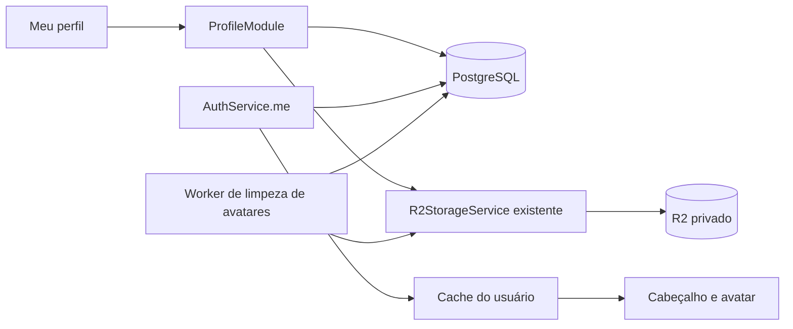
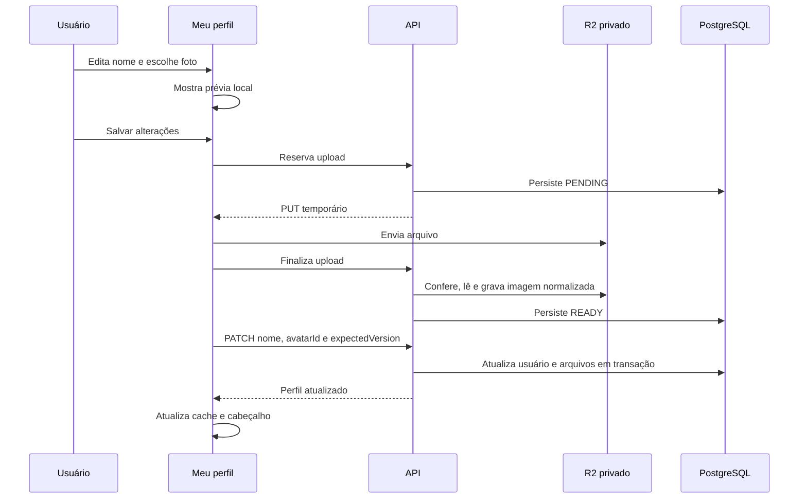

# Meu perfil — arquitetura

Data da arquitetura: 09/11/2026. Atualização: 10/11/2026. Estado: **código implementado e revisado; CORS corrigido e envio real de foto validado**.

Método: brainstorming com confirmação do entendimento, escolha entre três abordagens e validação incremental da estrutura, dos contratos e dos tratamentos de falha. O desenho aprovado está preservado abaixo; a seção 16 registra a implementação e seus limites de validação.

## 1. Entendimento confirmado

- Criar `/meu-perfil`, acessível pelo menu superior direito.
- Atender qualquer usuário autenticado e ativo, incluindo titulares administradores e usuários sem empresa cadastrada.
- Permitir alterar o próprio nome e adicionar, substituir ou remover a própria foto.
- Atualizar o mesmo nome de `users` originado pelo cadastro/aceite de convite, refletindo no cabeçalho e na administração de usuários.
- Manter um único nome e uma única foto atual por pessoa, compartilhados entre suas empresas e contratações.
- Concentrar a entrega nesses dados básicos; e-mail, senha, permissões e vínculos empresariais ficam fora do escopo.

## 2. Premissas e requisitos não funcionais

| Dimensão | Premissa validada e consequência |
| --- | --- |
| Desempenho | Atualizar o cabeçalho após salvar sem recarregar a página. Entregar imagem reduzida e buscar a autorização de leitura apenas quando necessário. |
| Escala | Acompanhar o volume atual da aplicação, com uma foto atual por usuário e limites para uploads temporários. Não há número de usuários, carga concorrente ou SLA quantitativo contratado nesta discussão. |
| Segurança e privacidade | Somente o próprio usuário altera seu perfil. Fotos privadas e validadas no servidor; identificação pela sessão. |
| Confiabilidade | Falhas antes da confirmação do salvamento preservam o perfil persistido. Falhas de leitura da imagem usam as iniciais. Limpeza física deve sobreviver a reinícios e falhas do R2. |
| Manutenção | Mesma aplicação e equipe, seguindo NestJS/Fastify, PostgreSQL/Drizzle, React, React Query, R2, Sharp e worker existentes. |
| Consistência | Mudança imediata na sessão que salvou. Outras abas, sessões e administradores recebem o dado nas próximas consultas, sem canal de atualização em tempo real. |

Limites validados: entrada JPEG, PNG ou WebP de até **5 MiB (5.242.880 bytes)**; imagem estática de até 20 milhões de pixels; saída com até 512 × 512 pixels; URL de leitura válida por até 120 segundos; upload pendente válido por 10 minutos; imagem pronta e abandonada válida por 24 horas.

Detalhes técnicos definidos nesta consolidação, ajustáveis por configuração sem alterar o comportamento principal: saída WebP com qualidade inicial 80 e teto de 1 MiB; até três uploads temporários ainda não limpos por usuário, excluindo a foto atual; até cinco novas reservas de upload por minuto por usuário; limpeza a cada minuto em lotes limitados. Esses valores não são medições de capacidade.

## 3. Base existente e pontos de integração

| Código existente | Evidência e uso |
| --- | --- |
| [schema.ts](../../backend/database/src/schema.ts) | `users` é global, com nome de até 200 caracteres. `company_users` controla vínculos empresariais. `stored_files` exige empresa e representa anexos de vendas. |
| [auth.service.ts](../../backend/src/auth/auth.service.ts) | `me()` consulta o usuário ativo. `verifyAccess()` também chama `me()`: essa leitura precisa continuar independente do R2. |
| [access.guard.ts](../../backend/src/auth/access.guard.ts) | `AccessGuard` identifica a pessoa e verifica origem em mutações autenticadas por cookie. `CompanyGuard` exige empresa e não se aplica ao perfil. |
| [users.service.ts](../../backend/src/users/users.service.ts) | O aceite de um novo usuário usa `invitedName`; a listagem de membros consulta `users.name`. Conta já existente mantém sua identidade no aceite. |
| [files.module.ts](../../backend/src/files/files.module.ts) | Exporta `R2StorageService`. Reutilizar transporte e credenciais; manter as regras de anexos de vendas no domínio atual. |
| [file-content.ts](../../backend/src/files/file-content.ts) | Há processamento de PNG/JPEG com Sharp, mas as regras atuais são de anexos e incluem PDF. O perfil precisa de um validador próprio com WebP e limites menores. |
| [file-cleanup-worker.service.ts](../../backend/src/jobs/file-cleanup-worker.service.ts) | Padrão existente de limpeza periódica, sem sobreposição no processo e com desligamento controlado. |
| [main.tsx](../../frontend/src/main.tsx) | `SessionGate` usa `['me']`; atualmente redireciona páginas sem empresa para `/empresa`. O perfil precisa de uma exceção específica. |
| [WorkspaceLayout.tsx](../../frontend/src/components/WorkspaceLayout.tsx) | Cabeçalho usa nome e iniciais; menu do perfil oferece apenas sair. |
| [UsersPage.tsx](../../frontend/src/features/users/UsersPage.tsx) | Listagem administrativa usa chaves iniciadas por `['managed-users']`. |

## 4. Abordagem escolhida e responsabilidades

**Ampliar `users` e criar `ProfileModule`.** Não criar uma tabela de dados básicos de perfil nem generalizar `stored_files` nesta entrega. A tabela nova descrita abaixo controla o ciclo de vida dos arquivos pessoais.



- `ProfileController`: contratos HTTP, validação de entrada e autenticação.
- `ProfileService`: edição do usuário, associação da foto, controle de versão, reservas e limpeza dos arquivos pessoais.
- Validador de avatar: assinatura real do arquivo, decodificação, orientação, remoção de metadados e normalização com Sharp.
- `R2StorageService`: operações de armazenamento já disponíveis, sem aplicar autorização ou quota empresarial ao perfil.
- `ProfileAvatarCleanupWorkerService`: executar a limpeza no worker existente, com estado durável no PostgreSQL.
- `ProfilePage` e `UserAvatar`: formulário e apresentação da foto/alternativa por iniciais.

`ProfileModule` importa `AuthModule` e `FilesModule`, além da infraestrutura de banco conforme o padrão existente. `AuthModule` não importa `ProfileModule`: `me()` apenas projeta os novos campos de `users`, evitando dependência circular e acesso ao R2 na autenticação. O worker registra o módulo e o serviço de limpeza.

## 5. Modelo de dados

### 5.1. Alterações em `users`

| Campo | Regra |
| --- | --- |
| `name` | Fonte única já existente; obrigatório, aparado nas extremidades, de 1 a 200 caracteres. |
| `avatar_id UUID NULL` | Foto atual; `NULL` significa usar iniciais. |
| `profile_version INTEGER NOT NULL DEFAULT 1` | Versão positiva, incrementada em cada alteração efetiva do perfil. |
| `updated_at` | Campo existente, atualizado junto com o perfil. |

### 5.2. Nova tabela `user_avatar_files`

| Grupo | Campos e finalidade |
| --- | --- |
| Identidade | `id UUID PK`, `user_id FK users`, `created_at`, `updated_at`. |
| Idempotência da reserva | `request_key`, `request_hash`; unicidade por usuário e chave. |
| Entrada | `input_mime_type`, `expected_bytes`. |
| Saída | `mime_type`, `size_bytes`, `width`, `height`, `sha256`; preenchidos após validação. |
| Armazenamento | `bucket`, `staging_key`, `object_key`, com chaves geradas pelo servidor. |
| Ciclo de vida | `status`, `upload_expires_at`, `unattached_expires_at`, `ready_at`, `deleted_at`, `staging_cleaned_at`, `object_deleted_at`. |

Estados: `PENDING`, `READY`, `ACTIVE`, `REJECTED`, `EXPIRED`, `DELETING`, `DELETED`.

- `PENDING`: reserva criada, sem conteúdo aceito.
- `READY`: conteúdo validado; ainda não é a foto do usuário.
- `ACTIVE`: foto associada em `users.avatar_id`.
- `REJECTED` ou `EXPIRED`: arquivo recusado ou fora da validade; bytes ainda podem aguardar limpeza.
- `DELETING`: exclusão física solicitada de forma durável.
- `DELETED`: exclusão física concluída.

Restrições e índices:

- FK composta de `users.(id, avatar_id)` para `user_avatar_files.(user_id, id)`, com unicidade correspondente, para impedir referência a uma foto de outra pessoa.
- FK simples do arquivo para o usuário; exclusão de contas permanece fora desta entrega e deve respeitar essas referências.
- Índice único parcial por `user_id` para arquivos `ACTIVE`, limitando a uma foto ativa por pessoa.
- Unicidade das chaves de objetos; índices por usuário/estado, expiração e pendência de limpeza.
- Checks para tipos, estados, tamanho positivo, dimensões de saída e versão positiva.
- `READY` e `ACTIVE` exigem metadados de saída completos e objeto ainda não excluído. A consistência entre `ACTIVE` e `users.avatar_id` é mantida na transação de associação.

Não armazenar binário, URL assinada ou nome de exibição duplicado. O nome usado no convite permanece como dado do convite; alterar o perfil não reescreve documentos históricos ou snapshots já emitidos.

## 6. Contratos HTTP

Todos os endpoints pessoais exigem `AccessGuard`, usuário ativo e autorização pelo `request.userId`. Não exigem `X-Company-Id`, contratação ativa ou papel administrativo. Corpos e parâmetros desconhecidos são rejeitados por schemas estritos.

### 6.1. `GET /auth/me` — ampliar o contrato existente

```json
{
  "id": "uuid-do-usuario",
  "name": "Maria Silva",
  "email": "maria@example.com",
  "avatarId": null,
  "profileVersion": 1
}
```

Não gerar links R2 nessa leitura. Atualizar as projeções de usuário retornadas por login, cadastro e aceite de convite para serem compatíveis com o mesmo DTO público. Preservar o mecanismo atual de tokens, cookies e renovação.

### 6.2. `POST /profile/avatar/uploads`

Header `Idempotency-Key` obrigatório. Corpo: `{ "mimeType": "image/jpeg", "sizeBytes": 245760 }`.

Resposta `201`: `{ "file": { "id": "uuid", "status": "PENDING" }, "upload": { "url": "temporaria", "method": "PUT", "headers": {}, "expiresAt": "ISO-8601" } }`.

Validar formato/tamanho e serializar a reserva pelo usuário para aplicar limites concorrentes. Assinar Content-Type, Content-Length e Cache-Control conforme o padrão existente. O navegador usa apenas os headers retornados que pode definir, envia os bytes sem cookies da aplicação e não recebe credenciais R2.

Mesma chave e mesmo conteúdo declarado reutilizam a reserva e sua validade original; outra entrada com a mesma chave gera `409`. Não criar URLs além de `upload_expires_at`. Uma reserva já concluída pode retornar `200`, com estado atual e `upload: null`; reservas expiradas, rejeitadas ou em exclusão exigem uma nova chave e novo envio. A chave não prova que os bytes enviados são válidos: essa verificação pertence à finalização.

### 6.3. `POST /profile/avatar/uploads/:id/complete`

Somente o proprietário pode finalizar. Conferir existência, estado e prazo; fazer HEAD e GET limitado, com correspondência de ETag, tamanho e MIME; decodificar e gerar a saída normalizada. Nunca expor a chave temporária como imagem final.

Resposta `200`: `{ "file": { "id": "uuid", "status": "READY", "mimeType": "image/webp", "width": 512, "height": 384, "sizeBytes": 32768 }, "expiresAt": "ISO-8601" }`.

A validade de 24 horas começa em `ready_at`. Finalizações repetidas devolvem o mesmo resultado aceito, sem reprocessar; se o arquivo já for `ACTIVE`, retornar esse estado. Finalizar não altera o perfil. Erro transitório preserva a possibilidade de tentar novamente dentro do prazo. Rejeição do conteúdo deve ser persistida antes de responder ao cliente.

### 6.4. `PATCH /profile/me`

```json
{
  "expectedVersion": 1,
  "name": "Maria Souza",
  "avatarId": "uuid-da-imagem-validada"
}
```

`expectedVersion` é obrigatório; exigir ao menos um entre `name` e `avatarId`.

- `name` omitido: preservar o nome atual.
- `avatarId` omitido: preservar a foto atual.
- `avatarId: null`: remover a foto.
- ID informado: aceitar somente imagem `READY`, não expirada, do próprio usuário; a referência atual `ACTIVE` também é aceita como preservação.

Em uma transação: bloquear o usuário, conferir status e versão, bloquear os arquivos envolvidos em ordem de ID, revalidar estados e prazos, desativar a foto anterior, ativar a nova, gravar nome/referência e incrementar a versão. A foto anterior passa para `DELETING` na mesma transação. Não chamar R2 para gravar o perfil.

Resposta `200`: o DTO de usuário atualizado, igual ao de `/auth/me`. Uma operação sem mudança efetiva retorna o perfil atual sem incrementar a versão, mas ainda confere `expectedVersion`. Divergência de versão retorna `409`; não sobrescrever automaticamente.

### 6.5. `GET /profile/avatar/access`

Consultar a foto atual e revalidar usuário, propriedade e estado `ACTIVE`. Resposta `200`: `{ "avatarId": "uuid", "url": "temporaria", "expiresAt": "ISO-8601" }`, com leitura inline de até 120 segundos. Sem foto, retornar `404`; a interface usa as iniciais.

Dados autenticados e respostas com URLs usam `Cache-Control: private, no-store`. O frontend compara `avatarId` retornado com o esperado para não instalar uma URL de uma versão diferente no cache. Não há endpoint de leitura de fotos de outros usuários nesta entrega.

## 7. Fluxo de salvar nome e foto



Alteração apenas de nome e remoção de foto seguem diretamente para o `PATCH`. O nome não é salvo antes do upload quando há uma troca pendente: o usuário confirma um único conjunto de alterações. Rascunho local ou arquivo `READY` não altera o cabeçalho.

## 8. Imagens, armazenamento e limpeza

### Processamento

- Aceitar JPEG, PNG e WebP reais, com assinatura e metadados compatíveis; rejeitar PDF, SVG, GIF, conteúdo corrompido e imagens animadas.
- Aplicar o limite de pixels antes de decodificar integralmente; limitar bytes efetivamente lidos e tempo de processamento.
- Corrigir orientação, remover EXIF/GPS e outros metadados e reencodar uma única imagem WebP.
- Redimensionar para caber em 512 × 512, preservando proporção e sem ampliar imagens menores. A apresentação circular usa CSS com `object-fit: cover`; não há editor de recorte.
- Limitar saída a 1 MiB. A imagem original não fica disponível para leitura pelo usuário.

### Chaves e disponibilidade

Usar o bucket privado configurado, com temporários em `uploads/avatars/{userId}/{fileId}/{uuid}` e saída em `avatars/{userId}/{fileId}/avatar.webp`. Cada versão tem uma chave própria. A regra complementar de expiração do prefixo `uploads/` pode atender os novos temporários; não aplicar expiração global ao prefixo definitivo `avatars/`.

Reutilizar configuração, cliente e métodos de R2 já existentes. Perfil não consome quota de empresa nem depende de `CompanyGuard`. Se o R2 estiver desabilitado ou indisponível, informar o erro ao tentar enviar/ler foto; edição de nome e remoção lógica continuam funcionando.

### Limpeza durável e concorrência

- O worker acompanha as duas chaves e os respectivos timestamps de exclusão, inclusive em estados `REJECTED` e `EXPIRED`.
- Nunca apagar o temporário antes do vencimento de sua URL PUT mais uma margem de um minuto, pois a URL pode ser reutilizada durante sua validade.
- `PENDING` vencido passa a `EXPIRED`; `READY` abandonado após 24 horas também expira. Ambos entram na seleção de limpeza enquanto houver bytes pendentes.
- Fotos substituídas/removidas são marcadas `DELETING` no salvamento. Após apagar os objetos, passam a `DELETED`. Registros técnicos podem permanecer para diagnóstico, sem manter os bytes da imagem.
- Antes da exclusão definitiva, bloquear o arquivo e conferir que não é o avatar atual de nenhum usuário. Associação bloqueia os mesmos arquivos e revalida seu estado, impedindo competição entre salvar e limpar.
- Processar lotes com `SKIP LOCKED`, requisições com timeout e repetição em ciclos posteriores. O worker não bloqueia linhas de usuário depois de bloquear arquivos, evitando inversão da ordem de locks do salvamento.
- Falhas após escrever no R2 e antes do commit não são atômicas entre os sistemas. As chaves são registradas antes do upload, permitindo que a limpeza remova objetos órfãos conhecidos após expiração. A finalização mantém lock do arquivo durante a operação limitada, como o fluxo existente.
- Limites de pendências consideram temporários e arquivos aguardando limpeza, não apenas estado `PENDING`, para conter acúmulo se o worker parar.

## 9. Interface e sincronização

### Página

- Link **Meu perfil** no menu superior direito, acima de **Sair**.
- Tela com foto/prévia, ações para escolher/substituir/remover, nome editável e e-mail apenas informativo.
- Um botão **Salvar alterações**, disponível quando houver mudanças válidas, e ação **Cancelar alterações** para restaurar o último estado conhecido.
- Estados de envio, processamento e salvamento distinguíveis; impedir envios duplicados e anunciar sucesso/erro de forma acessível.
- Cancelar antes de salvar não faz upload. Uma falha após upload preserva a imagem pronta para nova tentativa até sua validade. Trocar a seleção ou sair pode abandonar o arquivo, cuja limpeza é automática.
- Revogar URLs locais de prévia ao substituir a seleção ou desmontar a página. Preservar o formulário diante de falhas e conflitos, sem sobrescrever campos editados por refetch em segundo plano.

### Sessão, cabeçalho e navegação

- `User` passa a conter `avatarId: string | null` e `profileVersion: number`.
- `UserAvatar` compartilha leitura da foto atual entre página e cabeçalho, com cache por `['profile-avatar-access', user.id, user.avatarId]`.
- Renovar URLs ao vencerem ou quando a imagem precisar ser exibida novamente. Em falha de carregamento, permitir uma renovação limitada e depois usar iniciais; evitar ciclos infinitos. Logout limpa o cache existente.
- Após `PATCH` confirmado, substituir `['me']` com a resposta da API; invalidar leituras de avatar antigas e todas as consultas cujo prefixo seja `['managed-users']`, preservando a estrutura de chaves por contratação.
- O cabeçalho recebe os novos dados pelo fluxo já existente de `SessionGate`. Foto nova inválida ou indisponível usa as iniciais do nome salvo.
- Em outras sessões, o nome administrativo atualizado vem da consulta a `users.name`. Listagens já abertas só mudam na próxima consulta ou atualização; não criar WebSocket ou sincronização entre navegadores.
- A rota pessoal exige apenas sessão. Não esperar consulta de empresas para liberar seu conteúdo nem redirecionar para `/empresa` se a lista estiver vazia ou falhar. O seletor empresarial é complementar e fica indisponível quando necessário.
- Ao identificar `/meu-perfil`, ajustar título e estado de navegação do layout para não destacar **Clientes** indevidamente. Layout móvel, teclado e foco seguem os padrões existentes.

## 10. Falhas e respostas

| Caso | Resposta/comportamento esperado |
| --- | --- |
| Sessão inválida ou usuário inativo | `401`, usando renovação/login já existentes. |
| Origem inválida em mutação por cookie | `403`, pelo mecanismo atual. |
| Nome vazio, corpo inválido ou tamanho declarado inválido | `400`, sem alterar o perfil. |
| ID de arquivo inexistente ou de outro usuário | `404`, sem revelar o proprietário real. |
| Versão divergente, chave reutilizada com outro conteúdo ou upload ainda não recebido | `409`, mensagem específica. |
| Reserva ou imagem pronta fora do prazo | `410`; selecionar/enviar novamente. |
| Conteúdo acima do limite ou diferente do declarado | Recusar a finalização com erro de validação, persistindo `REJECTED` quando aplicável. |
| Tipo não aceito ou bytes inválidos | `400`, com orientação legível para selecionar outra imagem. |
| Limite de frequência ou pendências atingido | `429`, orientar a aguardar; liberar pendências pela limpeza. |
| R2 indisponível | `503` apenas nas operações que dependem dele; preservar formulário e perfil. |
| Falha no banco durante o PATCH | Rollback de nome, referência e estados; arquivo novo continua sem associação. |
| Resposta de salvamento perdida após commit | Resultado é desconhecido pelo cliente. Reconsultar `/auth/me` e comparar com a intenção antes de reenviar; não prometer rollback nem repetir cegamente com versão nova. |

Em conflito, preservar o rascunho e oferecer carregar o estado atual, com reaplicação explícita pelo usuário. Nunca atualizar silenciosamente `expectedVersion` para forçar a gravação.

Logs registram operação, IDs técnicos e classe de erro, sem conteúdo das imagens, credenciais, URLs assinadas ou nome/e-mail desnecessários. A URL assinada é uma credencial temporária: um link já emitido pode continuar válido até expirar após remoção ou logout.

## 11. Evolução e migração

Migration aditiva: criar a tabela técnica e seus índices; adicionar `avatar_id` inicialmente nulo e `profile_version` com padrão 1; criar as FKs após ambas as tabelas existirem. Nenhum arquivo atual ou nome existente precisa ser convertido.

Todos os usuários atuais começam com iniciais. Novos cadastros e aceites recebem os mesmos padrões. O nome de conta já existente não é substituído pelo nome de um novo convite.

Aplicar o fluxo de migrations Drizzle existente, com revisão do SQL e validação de constraints. API, worker e frontend precisam reconhecer o novo contrato; durante rollout, não habilitar a interface antes da API correspondente.

## 12. Mapa de arquivos previsto

Os itens abaixo são destinos previstos, não arquivos já criados nem um plano de implementação iniciado.

| Área | Alterações previstas |
| --- | --- |
| Banco | `backend/database/src/schema.ts` e nova migration em `backend/database/drizzle/`. |
| Perfil | `backend/src/profile/profile.module.ts`, `profile.controller.ts`, `profile.service.ts`, `profile.schemas.ts`, `profile.config.ts`, `avatar-content.ts`. |
| Registro de módulos | `backend/src/app.module.ts` e `backend/src/jobs/worker.module.ts`. |
| Worker | `backend/src/jobs/profile-avatar-cleanup-worker.service.ts`. |
| Identidade pública | `backend/src/auth/auth.service.ts` e projeções no aceite de `backend/src/users/users.service.ts`. |
| API frontend | `frontend/src/api/client.ts`, com DTOs e operações pessoais sem empresa. |
| Página e uploads | `frontend/src/features/profile/ProfilePage.tsx`, `profile.css`, `upload-avatar.ts`. |
| Avatar e navegação | `frontend/src/components/UserAvatar.tsx`, `WorkspaceLayout.tsx` e `frontend/src/main.tsx`. |
| Testes | Cobertura de backend/banco e `frontend/e2e/profile.spec.ts`, conforme padrões existentes. |

Reaproveitar transporte de upload quando houver uma extração pequena e justificável; não chamar o helper atual com empresa fictícia nem ampliar formatos dos anexos de vendas apenas para aceitar WebP no perfil.

## 13. Critérios de aceite e validação prevista

1. Usuário ativo, com ou sem empresa, abre `/meu-perfil`; falha no carregamento empresarial não impede a edição pessoal.
2. Salvar nome atualiza `users.name`, cabeçalho e consultas administrativas, mantendo o mesmo ID e vínculos.
3. Foto aceita aparece na página e no cabeçalho após salvar; selecionar ou cancelar não muda o perfil persistido.
4. Trocar ou remover foto mantém uma única foto ativa, com limpeza durável da anterior.
5. Nome e foto são confirmados juntos no PATCH. Falha de upload ou rollback do banco não salva parcialmente o nome.
6. Outro usuário, inclusive administrador, não consegue finalizar, associar ou acessar um arquivo pessoal alheio.
7. Arquivos falsos, animados, excessivos ou corrompidos são recusados no servidor; saída respeita dimensões, bytes e remoção de metadados.
8. Duas edições concorrentes geram um sucesso e um conflito, com rascunho preservado no cliente perdedor.
9. Reserva/finalização repetidas, expiração, resposta perdida e falha após PUT definitivo não geram associação incorreta ou arquivos inacessíveis à rotina de limpeza.
10. Limpeza concorrente com associação não apaga foto ativa; falhas e reinícios do worker preservam trabalho pendente.
11. R2 desabilitado não impede autenticação, edição de nome ou remoção lógica. Falha de imagem não produz repetição infinita.
12. URLs expiradas são renovadas com limite; logout limpa cache; navegação por teclado e layout móvel permanecem utilizáveis.
13. Convite de pessoa já cadastrada continua preservando seu nome; mudança de perfil não altera conteúdo de documentos históricos.
14. Fluxos atuais de arquivos de vendas preservam autorização empresarial, tipos e quotas existentes.

Validação futura: testes unitários de schema/processamento, integração transacional com PostgreSQL e armazenamento simulado, e E2E dos fluxos visíveis. Cobrir concorrência e recuperação onde há estado compartilhado; não depender apenas de mocks para demonstrar constraints e locks.

Na consolidação original da arquitetura não foram executados testes nem aplicadas migrations. A execução de 10/11/2026 está documentada na seção 16 e nos relatórios independentes.

## 14. Registro de decisões

| ID | Decisão | Alternativas consideradas | Motivo e validação |
| --- | --- | --- | --- |
| D01 | Perfil global ligado a `users.id`. | Perfil por empresa/contratação. | A mesma pessoa mantém identidade consistente entre seus vínculos. Entendimento confirmado. |
| D02 | Usar `users.name` como nome oficial editável. | Nome de exibição separado; preservar permanentemente o nome do convite como nome atual. | A alteração deve refletir no mesmo cadastro visto pelo administrador. Confirmado. |
| D03 | Ampliar `users` e criar módulo específico. | Criar `user_profiles`; generalizar o módulo de arquivos. | Menor complexidade e menor alcance da mudança. Opção 1 aceita expressamente. |
| D04 | Tabela técnica própria para ciclo de vida das fotos. | Apenas uma chave solta no usuário; usar `stored_files` vinculado a empresa. | Rastrear temporários, substituições e falhas sem mudar o domínio de anexos. Estrutura validada. |
| D05 | Autorização pessoal por sessão, incluindo acesso sem empresa. | Exigir empresa selecionada ou papel OWNER. | O perfil pertence à pessoa. Estrutura validada. |
| D06 | Upload privado em etapas e associação posterior. | Enviar por multipart na API; associar ao selecionar. | Seguir o padrão de R2 existente e manter a prévia como rascunho até salvar. Fluxo validado. |
| D07 | Um PATCH transacional para nome e referência da foto. | Salvar cada alteração automaticamente. | Um único botão confirma o conjunto sem gravar nome parcialmente após falha de foto. Validado. |
| D08 | Controle otimista com `profile_version`. | Última escrita vence. | Evitar perda silenciosa entre abas/sessões. Estrutura e tratamento validados. |
| D09 | Imagem estática normalizada de até 512 × 512, sem metadados. | Servir o original; permitir animação e recorte avançado. | Reduzir tamanho e manter o escopo básico. Formatos, pixels e tamanho de entrada validados; WebP de saída e teto técnico documentados como detalhamento. |
| D10 | Links privados de leitura de até 120 segundos. | Bucket público; URL permanente. | Respeitar privacidade. Limite de validade residual explicitado e aceito. |
| D11 | Limpeza assíncrona e persistida no banco. | Apagar apenas na requisição; limpeza somente em memória. | Recuperar falhas/reinícios sem desfazer o perfil salvo. Prazos de 10 minutos e 24 horas validados. |
| D12 | Cache local atualizado pela resposta; demais sessões por novas consultas. | WebSocket e sincronização imediata entre navegadores. | Atender o requisito sem infraestrutura adicional. Limite de atualização entre sessões explicitado e aceito. |
| D13 | E-mail, senha, permissões e acesso empresarial fora da entrega. | Central de configurações de conta completa. | Manter o escopo solicitado e confirmado. |
| D14 | Reutilizar R2/Sharp/worker sem generalizar anexos. | Criar serviço externo/CDN; reformular todos os arquivos. | Seguir a infraestrutura atual e limitar manutenção e regressões. Validado. |

## 15. Riscos, limites e estado final

- R2 e PostgreSQL não têm transação conjunta; registros prévios de chaves e limpeza repetível tratam os resíduos. Indisponibilidade prolongada do worker pode bloquear novos uploads pelos limites de pendências.
- URL de leitura já emitida pode continuar válida por até dois minutos. A exclusão física depende da execução do worker e da disponibilidade do armazenamento.
- O perfil é global: alterar o nome também muda sua apresentação em consultas atuais de outras empresas. Conteúdo histórico congelado não é reescrito.
- Outras sessões não recebem atualização instantânea; precisam de nova consulta. Não há SLA numérico de desempenho ou disponibilidade definido para esta funcionalidade.
- O processamento de imagem ocorre na API com limites e timeout. Reavaliar processamento em fila apenas se medições futuras de concorrência e latência justificarem.

**Perguntas de produto em aberto:** nenhuma dentro do escopo validado. Os parâmetros técnicos explicitamente indicados como ajustáveis não ampliam funcionalidades.

**Estado operacional:** edição de nome e envio de foto disponíveis. O bloqueio de CORS identificado na primeira validação foi corrigido e retestado, conforme seção 17.

## 16. Implementação e validação — 10/11/2026

Plano e comparação dos fluxos: [execução de Meu perfil](../superpowers/plans/2026-11-10-meu-perfil.md). Implementação por GPT-6.0 Sol; revisão de aderência, revisão de qualidade e testes independentes por GPT-6.1 Sol. Foram aproveitados os critérios de evidência e verificação de objetivos do GSD, sem iniciar o ciclo completo de fases. Nenhum commit foi executado.

- Backend, identidade, tabela técnica e worker implementados. Migration `0030_keen_sugar_man.sql` validada em PostgreSQL isolado e aplicada de forma aditiva no banco local.
- Rota `/meu-perfil`, formulário, envio em etapas, avatar compartilhado e menu implementados. Não é necessário ter empresa cadastrada para editar o perfil.
- **29/29** cenários independentes de backend e **44/44** regressões existentes aprovados. Typechecks e `db:check` aprovados.
- **21** cenários pessoais de navegador aprovados (20 na rodada principal e um focalizado de logout), além de **3/3** testes originais de usuários. Typecheck e build aprovados.
- Dois cenários de anexos passaram com ajuste temporário explícito de uma resposta fiscal simulada. A suíte original de anexos contém um mock incompatível com o contrato fiscal atual e não foi declarada aprovada sem esse ajuste; arquivos preexistentes foram preservados.
- Na primeira rodada, R2 real confirmou gravação, leitura, download assinado e exclusão pelo servidor, mas o navegador recebeu preflight PUT **403 sem allow-origin para ambas as origens locais**. A consulta de CORS pela credencial de objetos retornou **AccessDenied**. A correção e a revalidação posteriores estão na seção 17.
- Testes novos, scripts de probe, objetos temporários e saídas desta execução foram removidos após registrar os resultados. Não foram editados dados reais de usuários.

O código foi aprovado sem achados conhecidos abertos após quatro correções de backend/banco e quatro de interface. Detalhes e matriz dos 14 critérios: [revisão backend](../superpowers/reviews/2026-11-10-meu-perfil-backend.md) e [revisão frontend](../superpowers/reviews/2026-11-10-meu-perfil-frontend.md).

Para novos ambientes locais, incluir a regra de [cors.local.json](../../infra/r2/cors.local.json) no CORS do bucket privado, preservando regras existentes. A credencial de objetos da aplicação não é suficiente para configurar CORS; usar acesso administrativo autorizado. Não foi introduzido proxy de upload nem alterado o desenho aprovado.

## 17. Correção do CORS e validação real — 10/11/2026

O usuário relatou falha ao enviar a imagem de teste. A consulta administrativa com a sessão OAuth já existente do Wrangler revelou que o bucket permitia apenas origens nas portas antigas `5173`; o frontend atual usa `3001`.

A regra de `infra/r2/cors.local.json` foi adicionada usando a API oficial do Cloudflare e a autenticação existente do Wrangler. A regra anterior foi preservada integralmente, o bucket permaneceu privado e não foram criadas ou ampliadas credenciais. As origens adicionadas são `https://localhost:3001` e `https://127.0.0.1:3001`.

O GPT-6.1 Sol validou o fluxo no Chrome com API, PostgreSQL e R2 reais, usando uma identidade temporária de teste: reserva **201**, PUT no R2 **200**, finalização **200**, PATCH **200**, foto decodificada na página e no cabeçalho e registro ACTIVE com versão/nome corretos no banco. O próprio usuário também confirmou ter conseguido salvar sua foto.

Evidências e limpeza dos dados exclusivamente temporários: [validação real do R2](../superpowers/reviews/2026-11-10-meu-perfil-r2-real.md). Esta atualização encerra a pendência ambiental registrada na primeira rodada, sem alterar o protocolo de upload da arquitetura.
