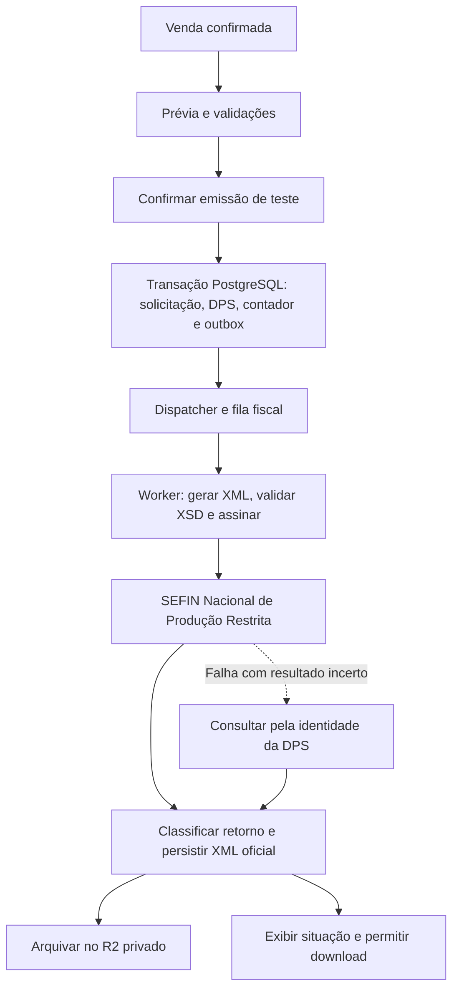
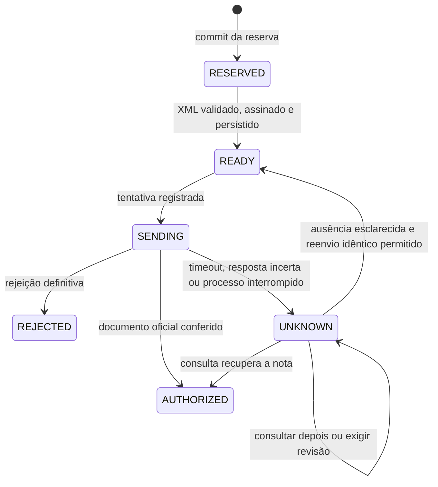

# Emissão de NFS-e nacional em homologação

Data: 29/10/2026. Atualização: 30/10/2026. Estado: arquitetura e implementação inicial. A prévia local, reserva, assinatura, transporte protegido e processamento foram adicionados. Nenhuma NFS-e foi autorizada no ambiente oficial: o contrato de transporte, a URL base e o perfil de assinatura precisam ser conferidos no Swagger atual antes da habilitação, e o certificado local de exemplo não é ICP-Brasil.

Objetivo: partir de uma venda do GestãoNF, preparar a declaração de prestação de serviços (DPS), assiná-la com o certificado da empresa, enviá-la ao ambiente oficial de **Produção Restrita**, obter uma NFS-e de teste autorizada e permitir consultar e baixar seu XML. Uma autorização de teste não tem validade fiscal e não representa uma certificação do software pelo governo.

Decisões e alternativas: [ADR do emissor nacional](adr-nfse-national-emission.md). Artefatos oficiais inspecionados e respectivas impressões SHA-256: [manifesto de pesquisa](nfse-national-research-manifest.json).

**Estado operacional da entrega:** os botões `Pré-visualizar NFS-e` e `Emitir NFS-e` aparecem em vendas confirmadas. A prévia não faz requisição fiscal, não assina e não reserva número. A confirmação de emissão só fica disponível para série padrão em homologação, certificado confiável e configuração fiscal/SEFIN explícita. Série de produção é identificada na prévia, mas seu envio permanece bloqueado nesta etapa. O worker consome `nfse.process` e `nfse.archive` da outbox PostgreSQL. A correção de DPS rejeitada e o cancelamento/substituição de NFS-e autorizada ainda exigem fluxo próprio antes de produção; a venda com solicitação fiscal é bloqueada contra edição/cancelamento comercial para preservar o histórico. A checagem local da cadeia usa raízes ICP-Brasil fornecidas pelo operador; revogação e autorização remota dependem da validação oficial e ainda não foram demonstradas em ensaio.

## 1. Escopo da entrega

- Empresas brasileiras com CNPJ, enquadradas como MEI/SIMEI ou ME/EPP optantes pelo Simples Nacional.
- Integração direta com a SEFIN Nacional; sem provedor fiscal intermediário e sem conectores municipais.
- Emissão regular pelo prestador, a partir de venda confirmada, para cliente brasileiro identificado por CPF ou CNPJ.
- Prévia, validação, agrupamento de serviços compatíveis, numeração automática, assinatura, transmissão, recuperação de resultado, armazenamento e download.
- Homologação habilitada primeiro. Produção permanece bloqueada por configuração do servidor até sua liberação específica.
- A operação fiscal não baixa recebíveis, não confirma pagamento e não altera os relatórios financeiros.

O primeiro cenário de aceite será uma prestação doméstica comum, sem retenções, benefícios, construção civil, evento ou operação internacional, com empresa e serviço reais habilitados no ambiente. O cadastro de MEI/SIMEI e o de ME/EPP exigem cenários próprios de validação; sucesso em um não comprova o outro.

Retenção, ISS fora do DAS por sublimite e outros casos condicionais têm representação prevista abaixo, mas só podem ser oferecidos após implementar e verificar suas regras. Exportação, obras, intermediação, imunidade, suspensão de exigibilidade, novos fatos geradores e decisões judiciais devem retornar impedimento explícito enquanto seus grupos específicos não estiverem disponíveis. Não converter uma operação especial em operação comum para conseguir transmitir.

Cancelamento e substituição de nota autorizada serão comandos fiscais próprios posteriores. A estrutura preserva a chave e os eventos para recebê-los. Corrigir uma DPS rejeitada, ainda sem NFS-e, é um fluxo diferente.

## 2. O que existe e o que falta no repositório

| Área | Implementado e reaproveitado | Complemento necessário |
| --- | --- | --- |
| Empresa | Identificação, endereço, município IBGE, opção pelo Simples, forma de apuração e regime municipal em `companies` | Validação para emitir, contexto pela competência e tratamento de divergência com o cadastro oficial |
| Cliente | CPF/CNPJ, nome, endereço e campos fiscais em `customers` | Validar limites e obrigatoriedades do leiaute sem tornar o cadastro comercial inteiro obrigatório |
| Serviço | `national_tax_code`, `nbs_code`, descrição e categoria de atividade em `services` | Código municipal quando aplicável, validação dos domínios oficiais e grupos específicos |
| Venda | Itens, descontos, snapshots, versão, regra tributária opcional e referência de série | Previsão fiscal, vínculo com emissão, controle de concorrência e indicação de notas por venda |
| Séries | `nfse_series`, contador por ambiente/identidade/município, ajustes auditados | Reserva transacional no comando de emissão; hoje não existe um método que reserve DPS |
| Tributos | Perfis e revisões em `nfse_tax_profiles` / `nfse_tax_profile_revisions` | Converter sugestões em campos fiscais válidos para o cenário, sem copiar percentuais indiscriminadamente |
| Livro de DPS | `nfse_dps` com identidade, chave de idempotência e seis estados | Snapshot fiscal, XML, tentativas, resultado e comandos de processamento |
| Certificado | Upload A1, validação local e envelope AES-256-GCM no PostgreSQL | Confiança ICP-Brasil, revogação, teste remoto e assinatura XML |
| Processamento | PostgreSQL, Redis/BullMQ, `integration_outbox`, processo `worker-main.ts` | Consumidores fiscais, recuperação de trabalho interrompido e tratamento de resultado desconhecido |
| Arquivos | R2 privado e cliente S3 em `files/r2-storage.service.ts` | Arquivamento de documentos fiscais gerados pelo servidor, separado dos anexos comerciais |
| Frontend | Portal de serviços, séries, impostos e certificado no modal da empresa | Prévia, comando de emissão, acompanhamento, histórico e documentos |

Evidências principais: `backend/database/src/schema.ts`, `backend/src/fiscal/*`, `backend/src/sales/sales.service.ts`, `backend/src/jobs/*`, `backend/src/files/r2-storage.service.ts`, `frontend/src/features/companies/CompanyPage.tsx` e `frontend/src/features/sales/*`.

A venda resolve atualmente `sales.fiscal_series_id` no ambiente **PRODUCTION**. A homologação deve resolver sua própria série no momento da emissão; não pode reutilizar esse vínculo comercial para consumir numeração de produção.

## 3. Contrato oficial e versões

### 3.1 Ambiente, competência e Simples

O [comunicado oficial de 29/10/2026](https://www.gov.br/nfse/pt-br/noticias/nfs-e-informa-diretrizes-sobre-a-obrigatoriedade-da-emissao-da-nfs-e-nacional-para-optantes-do-simples-nacional/) determina a emissão nacional de ME/EPP optantes pelo Simples para competências a partir de **01/11/2026**, independentemente de emissor próprio ou cadastro municipal. Competências anteriores podem continuar no emissor municipal de origem. Portanto, a decisão usa a **data da prestação**, não apenas a data do clique.

Em homologação, a habilitação efetiva do ambiente também deve ser verificada. Não mudar competência, regime ou município para contornar rejeições. Uma regra geral antiga de convênio municipal não pode bloquear automaticamente ME/EPP que já estejam cobertas pela obrigatoriedade nacional; indisponibilidade ou parametrização incompleta deve ser comunicada com o motivo recebido.

### 3.2 Pacotes distintos por ambiente

Em 20/10/2026, a Produção Restrita recebeu evoluções da NT 009. O comunicado prevê implantação em produção em 01/12/2026 e mantém a NT 004 em produção até 30/11/2026. [Comunicado oficial do release](https://www.gov.br/nfse/pt-br/noticias/cgnfs-e-informa-disponibilizadas-no-ambiente-de-testes-o-release-1-das-evolucoes-da-nota-tecnica-009).

| Ambiente | Referência consultada | Identificador interno proposto |
| --- | --- | --- |
| Homologação | Pacote `PRODREST-v1.01-20261020` e XSD dessa publicação | `national-homologation-20261020` |
| Produção atual | Anexo I e XSD `v1.01-20260209`; não habilitado nesta entrega | `national-production-20260209` |

O identificador interno inclui a revisão do pacote; o atributo XML `versao="1.01"` sozinho não distingue todas as publicações. Guardar `contract_version`, versão do gerador e hashes dos artefatos em cada DPS. Não escolher leiaute só pela competência nem atualizar XSD automaticamente ao iniciar o servidor: a compatibilidade depende também do ambiente e da implantação oficial.

O pacote de homologação foi baixado e seus XSD e planilhas foram inspecionados. Exemplo concreto: `finNFSe=0` aparece como elemento obrigatório diretamente em `infDPS` no XSD atual de testes. O gerador deve seguir a sequência do XSD correspondente, inclusive quando a posição apresentada em planilha ou manual antigo divergir. As regras semânticas da planilha continuam necessárias além do XSD. [Pacote oficial de homologação](https://www.gov.br/nfse/pt-br/biblioteca/documentacao-tecnica/producao-restrita).

### 3.3 Serviços oficiais

O [manual do contribuinte](https://www.gov.br/nfse/pt-br/biblioteca/documentacao-tecnica/documentacao-atual/manual-contribuintes-emissor-publico-api-sistema-nacional-nfs-e-v1-2-out2025.pdf) descreve recepção síncrona por `POST /nfse`, recuperação por `GET /dps/{id}` e consulta por `GET /nfse/{chaveAcesso}`. Nosso processamento será assíncrono para o navegador. A API também possui `HEAD /dps/{id}`; ele sozinho não recupera o documento necessário ao usuário.

Usar os [endereços oficiais por ambiente](https://www.gov.br/nfse/pt-br/biblioteca/documentacao-tecnica/apis-prod-restrita-e-producao/apis-prod-restrita-e-producao) para SEFIN, parâmetros municipais e documentos. O endereço Swagger de homologação publicado é `https://sefin.producaorestrita.nfse.gov.br/API/SefinNacional/docs/index`; `/docs/index` é documentação, não rota de envio.

**Limite desta pesquisa:** o Swagger da SEFIN retornou 403 na consulta HTTP e não pôde ser lido pela ferramenta web. Por isso, os caminhos funcionais acima estão confirmados pelo manual, mas o `servers`/base path exato, envelopes JSON, limites e códigos HTTP atuais precisam ser capturados do OpenAPI acessível no início da implementação. Não deduzir uma base URL de produção removendo palavras do endereço de homologação. As rotas internas da seção 11 são decisões do GestãoNF, não cópia do contrato externo.

O transporte será XML UTF-8 assinado, compactado em GZip e representado em Base64 dentro do envelope JSON exigido pela versão ativa. Fixar os nomes reais de propriedades no adaptador após capturar o OpenAPI; não espalhá-los pelo domínio ou frontend.

## 4. Fluxo para o usuário

1. No modal da empresa, completar os dados fiscais, instalar o certificado e executar **Testar conexão de homologação**. O resultado separa arquivo válido, confiança do certificado, comunicação e autorização da operação consultada.
2. Em Fiscal → Séries e numeração, cadastrar uma série padrão de homologação. A série é vinculada à empresa/CNPJ e não será escolhida em cada venda.
3. Abrir uma venda confirmada e clicar **Emitir NFS-e de teste**. O sistema mostra cliente, empresa, competência, serviços, regra escolhida na venda, valores e quantas notas serão geradas.
4. Se faltarem dados, mostrar os campos e atalhos para empresa, cliente ou serviço. Não reservar número nesse momento.
5. Confirmar o resumo. O backend reserva os números, registra a solicitação e devolve seu ID. A tela acompanha o processamento e continua funcionando após recarregar.
6. Em autorização, mostrar número da nota, série/número da DPS, chave, ambiente e botão **Baixar XML**. O documento pertence ao ambiente de testes.
7. Em rejeição, mostrar motivo e ação de correção. Em falha de conexão com resultado incerto, mostrar **Consultando resultado** e impedir nova emissão da mesma operação até esclarecer o que ocorreu.

Manter a escolha opcional de regra tributária junto ao cliente na venda, com **Sem regra** como padrão. Sem regra significa ausência de preenchimento antecipado; a emissão ainda exige os campos obrigatórios do cenário. Não exigir criar um perfil tributário para uma nota que possa ser preenchida corretamente sem ele.

## 5. Arquitetura de aplicação

Preservar o monólito modular NestJS/Fastify e o processo de worker existente. Não criar um microsserviço fiscal para esta entrega.



Organização proposta:

```text
backend/src/fiscal/
  issuance/               controller, schemas, preview, request e consulta
  national/               client HTTPS, parâmetros e tradução de respostas
  xml/                    gerador, validação XSD, assinatura e inspeção do retorno
  contracts/              pacotes oficiais versionados e manifesto de execução
  certificates/           expansão do serviço atual; identidade, cadeia e uso interno
  documents/              XML oficial, arquivo privado, download e histórico
backend/src/jobs/
  nfse-worker.service.ts
  nfse-reconciliation-worker.service.ts
frontend/src/features/fiscal/
  emissão, listagem e detalhe da nota
```

Responsabilidades:

- `NfsePreviewService`: reúne dados, prepara grupos, calcula valores, aplica regras e produz hash de prévia. Não reserva nem transmite.
- `NfseIssuanceService`: autentica o comando, verifica a prévia novamente, controla versão/idempotência e reserva em transação.
- `NationalContractRegistry`: escolhe pacote e regras por ambiente e política vigente; falha se o contrato não estiver instalado/verificado.
- `NationalEligibilityService`: confere escopo, competência e disponibilidade; guarda evidências, sem inventar uma API de consulta ao Simples que não esteja autorizada ao contribuinte.
- `NationalParametersService`: consulta parâmetros aplicáveis e mantém snapshots por ambiente/competência.
- `DpsXmlBuilder` / `XmlSchemaValidator` / `XmlSignatureService`: geram, validam e assinam sem acessar o frontend.
- `NationalNfseClient`: usa certificado de cliente, timeouts e limites, sem retry automático de POST.
- `NfseResultService`: valida XSD, autenticidade e identidade do retorno e registra autorização/rejeição; é idempotente para retorno de envio ou de recuperação.
- `NfseReconciliationService`: esclarece resultado desconhecido antes de permitir qualquer nova declaração.
- `FiscalDocumentStore`: preserva os bytes originais no banco e arquiva cópia no R2.

O `FiscalModule` é importado pelo `WorkerModule` sem dependência circular com `SalesModule`: a camada fiscal consulta a venda pelo banco/serviço de leitura. O serviço de venda pode consultar uma política fiscal pequena para bloquear alterações incompatíveis.

## 6. Dados que compõem a emissão

### 6.1 Prestador e certificado

- Resolver `company_id` pelo contexto autenticado (`AccessGuard`, `CompanyGuard`, `X-Company-Id`). Todas as buscas e FKs incluem a empresa.
- Exigir CNPJ válido, empresa ativa, país BR, município IBGE, identificação e demais campos exigidos na operação. Nome/endereço cadastrados alimentam prévia e snapshot; o XML só leva o que o contrato permite, pois alguns dados são recuperados do cadastro nacional.
- Usar `opSimpNac=2` para MEI e `3` para ME/EPP; não inferir essa informação apenas do faturamento ou nome do porte. O governo confere a condição na competência.
- O cadastro atual aceita valor `4` em `simples_national_option`, mas o XSD de homologação consultado aceita somente `1`, `2` e `3`. Não enviar `4`: revisar seu significado no cadastro e bloquear emissão até o enquadramento correto estar definido. O valor `1` fica fora do escopo deste produto.
- `regApTribSN` é exclusivo de ME/EPP e não deve ser enviado para MEI. Guardar a forma de apuração declarada para a competência; discrepâncias retornadas pelo governo exigem revisão do cadastro.
- Inscrição municipal é condicional. Não exigir de todos nem mandar uma inscrição inventada; considerar cadastro complementar e exceções efetivamente aplicadas ao Simples.

O caminho inicial usa **A1 e-CNPJ da própria prestadora**, com correspondência integral do CNPJ. Procuração, e-CPF do responsável e uso entre matriz/filial terão fluxos explícitos posteriores; não estão implicitamente autorizados pelo suporte a certificado no portal web.

### 6.2 Cliente

O tomador inicial é o cliente da venda, brasileiro e identificado. Validar CPF/CNPJ, nome e endereço quando exigidos. Os limites fiscais podem ser menores que os comerciais: por exemplo, e-mail de até 80 caracteres, razão social de até 150 e bairro de até 60 nos tipos consultados. Não truncar silenciosamente dados para passar no XSD. Informar exatamente qual campo precisa ser ajustado ou confirmado para a nota.

### 6.3 Serviço e operação

Cada grupo deve conter classificação nacional válida de seis dígitos (`cTribNac`), descrição de até 2.000 caracteres, local da prestação, competência e valores. NBS é validado no domínio oficial quando informado e torna-se obrigatório nas hipóteses do contrato; não exigir NBS indiscriminadamente em toda prestação doméstica de 2026. Código municipal de três dígitos (`cTribMun`) é condicional e não pode ser enviado no cenário MEI do pacote consultado.

Complemento de cadastro proposto: `service_fiscal_municipal_settings`, com `id`, `company_id`, `service_id`, `municipality_ibge_code`, `national_tax_code`, `municipal_tax_code`, `effective_from`, `effective_to`, `created_by_user_id`, timestamps e versão. FK composta para o serviço; nenhuma vigência pode se sobrepor para a mesma empresa/serviço/município. O município da tributação não será presumido sempre igual ao endereço do cliente ou do prestador.

O código municipal pode ser confirmado na prévia sem obrigar esse pré-cadastro; a nota guarda o valor escolhido. A categoria de atividade do serviço já cadastrada continua como informação auxiliar: não mapear para uma tag inexistente no XSD nem confundi-la com o código nacional.

### 6.4 Valores, retenções e tributos

- Competência é uma data própria; sugerir `performed_on` do item e, se ausente, solicitar confirmação da data da prestação. Pagamento e vencimento não definem competência.
- Copiar a regra/revisão escolhida na venda para a prévia como sugestão. Validar sua adequação para a competência; nenhuma atualização automática do cadastro altera uma nota já preparada.
- Preservar valor bruto, desconto incondicional e valor líquido. Não enviar o valor já descontado como bruto e descontá-lo novamente. Desconto condicionado é um campo separado se essa operação for suportada.
- Calcular dinheiro com centavos/decimais, sem aritmética binária de ponto flutuante. Percentuais têm escala interna maior; o XML segue a escala permitida em cada campo. Se um valor não for representável, pedir confirmação, sem arredondamento tributário oculto.
- `tpRetISSQN` indica não retido, retido pelo tomador ou pelo intermediário. Não traduzir o booleano de sugestão atual para qualquer um dos três sem contexto.
- No cenário comum de ME/EPP com ISS no Simples e sem retenção, o pacote contém regras que **proíbem informar `pAliq`**. Logo, ter uma alíquota cadastrada não significa que ela deva ir para o XML.
- Com retenção, ou ISS fora do DAS, aplicar as regras específicas de obrigatoriedade da alíquota, município e benefício. `regApTribSN=2` pode acontecer com EPP ainda optante pelo Simples; isso não justifica encaminhar automaticamente para uma API municipal. Antes de liberar esse cenário, implementar sua apuração e consulta de parâmetros.
- PIS/Cofins, IR, CSLL e INSS não são preenchidos em todas as notas pela simples existência de percentuais no perfil. Grupos, base, códigos e retenções precisam corresponder à operação suportada.
- Tributos aproximados da nota são distintos do ISS e de retenções. Acrescentar ao modelo da prévia `totalTaxInformationMode` e, quando cabível, `simplesTotalTaxPercent`; não substituir esse total pela alíquota de ISS. MEI e ME/EPP têm escolhas diferentes permitidas no grupo `totTrib`.
- Para o cenário Simples de 2026, omitir grupos IBS/CBS quando não exigidos. Há tratamento a partir de 2027 previsto na orientação oficial; o suporte de 2026 não deve ser anunciado como pronto para janeiro sem implementar o perfil correspondente. [Orientação da Receita sobre novembro e janeiro](https://www.gov.br/receitafederal/pt-br/assuntos/noticias/2026/agosto/simples-nacional-nfs-e-nacional-sera-obrigatoria-para-me-e-epp-a-partir-de-1o-de-novembro-de-2026).

As condições fiscais desta seção são extraídas do [Anexo I de homologação](https://www.gov.br/nfse/pt-br/biblioteca/documentacao-tecnica/producao-restrita/anexo_i-sefin_adn-dps_nfse-snnfse_prodrest-v1-01-20261020.xlsx), juntamente com os XSD. A implementação deve transformar as condições do cenário habilitado em validações identificáveis, mantendo código da regra e versão do pacote.

### 6.5 Vendas com vários serviços

O leiaute possui um grupo de serviço e classificação por DPS; não é uma lista livre de produtos como a NF-e. O GestãoNF criará **uma solicitação de emissão por venda e ambiente**, contendo uma ou mais DPS.

Agrupar apenas itens compatíveis em: competência, tomador, local da prestação, incidência, código nacional, NBS, código municipal, natureza da operação, regime, retenções, percentuais aplicáveis e parâmetros dos grupos especiais. Cada item precisa pertencer a exatamente um grupo, com seus valores integrais; não há faturamento parcial nem fracionamento de quantidade nesta primeira entrega.

Somar valores dentro do grupo e compor descrição legível com os serviços. Se a descrição ultrapassar o limite, pedir revisão; não cortar conteúdo. Classificações diferentes geram notas distintas. A prévia mostra essa divisão antes da confirmação. Uma rejeição em uma nota não desfaz outra já autorizada: a solicitação pode ficar parcialmente concluída.

## 7. Banco de dados

Manter PostgreSQL/Drizzle. Migrações são aditivas e não recriam as tabelas existentes. Números fiscais, chave e inscrições são strings nos DTOs; `nDPS` continua `bigint` no banco. Usar `numeric` para valores e timestamps com fuso para eventos.

### 7.1 `nfse_emission_requests` — nova

| Campo | Finalidade |
| --- | --- |
| `id`, `company_id`, `source_sale_id`, `source_sale_version` | Identidade e origem comercial |
| `environment`, `provider` | Homologação ou produção; inicialmente `NATIONAL` |
| `request_key`, `request_hash`, `preview_hash` | Idempotência do comando e prévia confirmada |
| `source_snapshot`, `grouping_version` | Dados completos da venda e divisão aprovada, imutáveis |
| `status`, `needs_review_reason`, `version` | Acompanhamento agregado e concorrência |
| `created_by_user_id`, `created_at`, `updated_at` | Auditoria |

Unicidades: `(company_id, request_key)` e `(company_id, source_sale_id, environment)`. FK composta para a venda e para seu usuário autorizado. A segunda unicidade é uma política de **uma emissão integral por venda/ambiente**. Correções de DPS rejeitadas acontecem dentro da mesma solicitação; não se cria outra solicitação integral duplicando os grupos já emitidos.

Estados agregados: `QUEUED`, `PROCESSING`, `AUTHORIZED`, `PARTIAL`, `REJECTED`, `NEEDS_ATTENTION`. O agregado é recalculado a partir das últimas DPS de cada grupo, dentro das transações que alteram o resultado. `PARTIAL` identifica ao menos uma autorização e grupos ainda pendentes ou rejeitados.

### 7.2 `nfse_dps` — ampliar a existente

Preservar `series_id`, ambiente, identidade fiscal, série, `dps_number`, `request_key`, `request_hash`, autoria e estados atuais. Acrescentar:

- `emission_request_id`, `group_key`, `group_revision`, `predecessor_dps_id` e `is_current` para correção de grupo rejeitado.
- `dps_identifier` (45 posições), `competence`, `issued_at`, `contract_version`, `application_version` e `signature_profile`.
- `fiscal_snapshot` e `source_items_snapshot` imutáveis: empresa, cliente, itens de origem e valores, contexto municipal, classificação, regra/revisão, campos fiscais confirmados e versão das regras.
- `signing_certificate_id` e impressão digital do certificado efetivamente usado.
- `signed_xml_gzip` (`bytea`), `signed_xml_sha256` e `payload_sha256` para preservar o documento exato enviado. O hash do comando, o hash do XML e o hash do envelope são coisas distintas.
- `preparation_error`, `processing_blocked_reason`, `next_action_at`, `lease_token`, `lease_expires_at`, `send_started_at` e `last_reconciled_at`.
- Metadados de arquivamento do XML assinado: bucket, chave, estado e hash.

Adicionar unicidade composta `(company_id,id)` para FKs dos filhos; FK composta para solicitação, certificado e predecessora. Unicidade de `dps_identifier` **por ambiente**; a mesma identidade pode existir em teste e em produção. Índice parcial de uma revisão `is_current=true` por solicitação/grupo. Manter unicidade fiscal atual e validar coerência com a série no comando transacional; o frontend não fornece CNPJ, número ou identificador prontos.

Os IDs dos itens em `source_items_snapshot` são referências históricas acompanhadas de seus valores, não FKs para linhas comerciais mutáveis. A identidade dos serviços existentes continua registrada, mas regenerar um item de venda não pode apagar o conteúdo da declaração.

`nfse_dps.request_key` é uma chave própria de cada grupo/revisão, gerada pelo servidor. Não repetir a chave da solicitação em todas as DPS, pois sua unicidade atual é por empresa. A relação solicitação/grupo/revisão determina o trabalho a reaproveitar em uma entrega repetida.

### 7.3 `nfse_documents` — nova

Uma linha por NFS-e efetivamente autorizada: `id`, `company_id`, `dps_id`, `environment`, `access_key` (50 caracteres), `nfse_number` como texto, código de verificação quando retornado, município, identificação do prestador, competência, valores oficiais, `authorized_at`, situação fiscal e timestamps.

Guardar `official_xml_gzip` e `official_xml_sha256`, bytes recebidos e preservados, mais metadados de versão. Unicidades `(company_id,dps_id)` e `(environment,access_key)`. FK composta para DPS. Nenhum número ou chave é inventado antes de chegar do governo.

Arquivo no R2: `archive_status`, `archive_bucket`, `archive_key`, `archive_sha256`, `archived_at`. PDF: `danfse_status`, `danfse_source`, chave/hash de arquivo quando disponível e erro recuperável. XML autorizado é obrigatório para o aceite; PDF não determina a autorização.

### 7.4 `nfse_transmission_attempts` — nova

`id`, `company_id`, `dps_id`, `attempt_number`, `operation` (`SEND`, `LOOKUP_DPS`, `FETCH_NFSE`), `environment`, `contract_version`, `transport_certificate_id`, timestamps, duração, HTTP status, resultado classificado, código/motivo, `correlation_id`, hashes de requisição/resposta e resposta técnica limitada/comprimida.

Unicidade `(company_id,dps_id,attempt_number)`; FK composta para DPS e certificado. Registrar início **antes** da chamada. A fila transporta IDs, nunca PFX, senha ou XML. Respostas completas ficam restritas à área fiscal e fora do log geral; limitar corpo e tamanho descompactado antes de guardar ou interpretar.

### 7.5 `nfse_events` — nova

Histórico imutável de solicitação, DPS e documento: `id`, `company_id`, IDs relacionados, `event_type`, `actor_user_id` opcional para eventos do worker, `created_at`, `correlation_id`, código/motivo e metadados mínimos. Exemplos: solicitação criada, número reservado, assinado, envio iniciado, rejeitado, resultado desconhecido, recuperado e autorizado.

Eventos de domínio não se confundem com eventos fiscais oficiais. Campos separados `origin=APPLICATION|GOVERNMENT`, código oficial, sequência e artefato permitirão cancelamento/substituição futuros. Cancelar uma venda nunca cria por inferência um evento fiscal de cancelamento.

### 7.6 Evidências auxiliares

- `nfse_municipal_parameter_snapshots`: ambiente, município, código de serviço, competência/data de referência, tipo de consulta, contexto do contribuinte quando necessário, versão do contrato, resposta JSON, hash, `fetched_at` e validade. Não compartilhar parâmetros pessoais entre empresas; cache de parâmetros públicos pode ser comum quando a chave realmente não contém informação de contribuinte.
- `nfse_certificate_checks`: empresa, certificado, ambiente, verificação de cadeia/revogação, evidência e validade, resultado de TLS, operação remota e resultado sem segredos. Substituir o certificado invalida o aproveitamento de verificações anteriores para o novo arquivo.
- `service_fiscal_municipal_settings`: complemento descrito na seção 6.3.

Não acrescentar uma tabela genérica de uploads de XML nem abrir o fluxo de anexos de contrato para gravar documentos fiscais. Reaproveitar o cliente R2, com regras fiscais próprias.

## 8. Numeração, idempotência e concorrência

### 8.1 Prévia sem reserva

`preview_hash` cobre empresa, versão da venda, snapshots relevantes de cadastros e parâmetros, competência, grupos, valores, contrato e escolhas fiscais. A prévia tem validade curta proposta de cinco minutos. Devolver também `previewToken` assinado com chave própria, contendo propósito `nfse-preview`, empresa, usuário, venda, ambiente, hash, emissão e expiração. O token contém referências e hash, não dados pessoais ou segredos. A chave difere de `JWT_SECRET` e da chave do PFX, para que esse token nunca seja aceito como sessão.

Na confirmação, verificar assinatura, propósito, vínculo e expiração do token; o backend reconstrói o contexto e compara o hash. Mudanças devolvem conflito com solicitação de nova revisão, sem reservar número. A repetição de um comando já aceito pela mesma chave idempotente devolve a solicitação existente mesmo após a prévia expirar, desde que empresa, usuário autorizado e conteúdo coincidam.

### 8.2 Transação curta de confirmação

1. Validar sessão, permissão, empresa e ambiente habilitado.
2. Buscar/reproduzir comando existente pela chave idempotente. Mesma chave com conteúdo diferente retorna 409.
3. Bloquear a venda `FOR UPDATE` e conferir versão, estado `CONFIRMED` e ausência de emissão integral concorrente naquele ambiente.
4. Confirmar que os dados comerciais/cadastrais usados na prévia não mudaram; usar leitura consistente e checagem/bloqueio das fontes necessárias, com ordem fixa de locks.
5. Resolver série padrão **do ambiente solicitado**, CNPJ e município emissor. Sem padrão e com múltiplas séries, pedir configuração em Fiscal; não adivinhar.
6. Bloquear a série e reservar sequencialmente um número por grupo; incrementar `next_number` e sua versão.
7. Inserir solicitação, DPS e snapshots, eventos e outbox `nfse.prepare-send` na mesma transação. Falha antes do commit desfaz tudo.
8. Retornar 202 com os IDs e o ambiente. Esse 202 é a aceitação do trabalho pelo GestãoNF, não a autorização da nota pelo governo.

Nenhuma chamada HTTP, assinatura ou upload R2 ocorre segurando esses locks. A faixa interna atual de séries `1..49999` é válida para o produto; o pacote consultado admite série zero também, mas não é necessário ampliar o cadastro para emitir. A sequência de DPS chega a 15 dígitos; verificar esgotamento antes de reservar.

Depois do commit, o número reservado nunca volta ao contador. Reinício, rejeição e falha de assinatura mantêm a trilha da reserva. Identificador no pacote consultado: `DPS` + município (7) + tipo de inscrição (1) + inscrição federal (14) + série preenchida (5) + número preenchido (15). Para CNPJ, o tipo da inscrição é `2` no XSD atual. Não confundir esse identificador com chave da NFS-e nem com número do pedido comercial.

### 8.3 Bloqueio de alterações comerciais

Enquanto existir DPS preparada para envio, em envio ou com resultado desconhecido, bloquear alterações de cliente, serviço, valores e dados que invalidem aquela emissão. Após autorização, esses dados permanecem protegidos até existir o fluxo fiscal de correção/cancelamento correspondente. Pagamentos podem continuar sendo registrados separadamente.

Uma solicitação parcialmente autorizada continua protegida. A ação de correção atua somente nos grupos definitivamente rejeitados e gera nova revisão auditada; não reemite os grupos autorizados. Se todos os grupos forem rejeitados, permitir corrigir dados pela operação fiscal e revalidar o conjunto, preservando o histórico anterior.

### 8.4 Worker e recuperação

Usar `integration_outbox` e BullMQ existentes com tópicos `nfse.prepare-send`, `nfse.reconcile` e `nfse.archive`. O dispatcher atual reconhece apenas tópicos WhatsApp; precisa de roteamento fiscal, fechamento das filas e política própria, sem herdar o retry de POST dos outros consumidores.

Entregas repetidas são esperadas. Cada worker toma lease no banco com token, verifica estado e atualiza usando compare-and-set; job ID determinístico ajuda, mas não é a garantia de unicidade. Acrescentar `transmission_lease_token` e `transmission_lease_expires_at` à série, adquiridos atomicamente para limitar a uma transmissão por série entre processos. Dar preferência ao menor número pendente; uma DPS `UNKNOWN` impede ultrapassá-la com novo envio na mesma série até esclarecer o resultado. O lock do Redis não substitui as condições e unicidades no PostgreSQL.

Registrar `SENDING` e tentativa antes do envio. Se o processo morrer depois disso, uma lease expirada leva a `UNKNOWN`, nunca diretamente a um novo POST. Esperar a janela máxima da chamada e consultar a mesma identidade da DPS. Usar timeout total e cancelamento real da conexão; resultado de uma tentativa ainda em voo não pode ser sobrescrito por outro worker.

## 9. Assinatura, conexão e validação técnica

### 9.1 Certificado

O certificado autoassinado mostrado no teste anterior serve para testar o cadastro local. As regras de recepção e assinatura do pacote oficial exigem cadeia ICP-Brasil e verificações de validade/revogação também no ambiente de testes. Será necessário um A1 válido da empresa que efetivamente participará da homologação oficial.

O serviço atual precisa manter distintas as condições: arquivo/senha válidos, identidade compatível, cadeia confiável, revogação verificada e uso remoto aceito. Um HTTP 401/403 ou rejeição cadastral não pode resultar em “pronto para emitir”. Um handshake concluído não comprova sozinho autorização de emissão.

Antes de usar o serviço atual com documentos reais, revisar a extração de identidade: ele remove caracteres não numéricos de todo `otherName` e usa os primeiros dígitos. Isso não serve para CNPJ alfanumérico; o OID de CPF também possui posição própria depois da data de nascimento. O fluxo inicial e-CNPJ deve preservar o conteúdo textual do OID de CNPJ e seus dígitos verificadores. [Definição oficial de identidade no certificado](https://www.gov.br/iti/pt-br/assuntos/legislacao/resolucoes/resolucoes-old/resolucao179_doc-icp-04.htm).

Manter PFX e senha criptografados no PostgreSQL com a chave fiscal separada já existente. Uso da chave privada apenas em memória e dentro de serviço interno; acesso mínimo, descarte dos buffers quando possível, sem persistir PEM ou passphrase em arquivo. Acrescentar verificação de vínculo/estado/CNPJ a cada uso, pois `credential()` atual apenas resolve o certificado ativo e sua validade.

Validação de confiança usa pacote de raízes ICP-Brasil e intermediárias versionado, verificação criptográfica e revogação com evidência/validade. URLs de LCR/AIA vindas de certificados não podem permitir acesso arbitrário a serviços internos: limitar destinos/protocolos, tamanho, redirecionamentos e tempo. Falha de consulta fica pendente/bloqueada, nunca equivale a “não revogado”.

### 9.2 XML e ferramentas

Gerar XML por API estruturada, com namespace fiscal padrão, UTF-8, ordem do XSD e escape de texto. Campos opcionais ausentes são omitidos; valores zero são incluídos somente quando permitidos. Rejeitar DTD/entidades externas nos documentos recebidos e limitar XML/GZip descompactado. Não inserir prefixos arbitrários no namespace fiscal.

Assinar `infDPS` pelo seu `Id`, com uma única referência, XMLDSIG enveloped e certificado final no `KeyInfo`. A assinatura fica na posição definida pelo XSD; nunca assinar um texto diferente dos bytes que serão compactados/enviados. Validar XSD e conferir a assinatura localmente antes de transmitir. Ao verificar uma assinatura, usar o conteúdo autenticado pela referência e impedir IDs duplicados ou troca do elemento assinado.

Decisão de ferramentas: biblioteca mantida de XMLDSIG, inicialmente `xml-crypto`, e validador XSD real baseado em libxml2 (`xmllint` versionado no runtime da API/worker). Executar o validador sem shell, com XML em stdin e schemas locais confiáveis, timeout e limites. Disponibilizar o mesmo runtime em desenvolvimento Windows e no deploy; não substituir XSD por regex ou por “XML bem formado”. [XMLDSIG para Node](https://github.com/node-saml/xml-crypto), [validação XSD no libxml2](https://gnome.pages.gitlab.gnome.org/libxml2/xmllint.html).

**Perfil criptográfico a confirmar no contrato ativo:** o manual integrado histórico descreve RSA-SHA1 e C14N; o XSD XMLDSIG atual não restringe sozinho todos os algoritmos. Não assumir RSA-SHA256 por preferência nem copiar o exemplo histórico como prova de aceitação atual. A etapa inicial da implementação deve fixar URIs de assinatura/digest/canonicalização e transformações com evidência do contrato e um ensaio oficial aceito. Até isso ocorrer, `signature_profile` permanece não verificado e o envio fica bloqueado. [Manual histórico, somente referência](https://www.gov.br/nfse/pt-br/biblioteca/documentacao-tecnica/leiaute-e-esquemas-antigos/manualintegradosnnfse_v1-00-02-producao.pdf).

### 9.3 Transporte

Cliente HTTPS com autenticação mútua e certificado da empresa; usar `node:https` com agente isolado por credencial/uso e TLS mínimo compatível com o serviço oficial. Validar certificado e hostname do servidor, sem `rejectUnauthorized=false`, redirecionamento automático ou URL fornecida pelo usuário. [Documentação oficial do Node](https://nodejs.org/api/https.html).

Configurações de timeout são decisões operacionais iniciais: conexão 10 segundos, chamada total 45 segundos, resposta compactada e descompactada limitadas. Ajustar os limites ao OpenAPI capturado. POST não tem retry automático da biblioteca HTTP. Proteger também o tamanho dos logs/erros gerados pelo validador, pois eles podem conter trechos fiscais.

O serviço deve persistir e reutilizar exatamente o XML assinado de uma tentativa de transporte. Troca de certificado ou de dados não provoca nova assinatura silenciosa de uma declaração com resultado desconhecido. Para consulta, pode ser usado o novo certificado válido da mesma empresa quando aceito pelo contrato; guardar qual credencial foi usada em cada operação.

## 10. Estados e tratamento dos resultados



Falha de preparação mantém `RESERVED` com erro e processamento bloqueado até correção técnica. Não classificar como rejeição do governo. Falha comprovada antes de iniciar o envio pode voltar a `READY`; se houver dúvida sobre o recebimento, usar `UNKNOWN`.

| Resultado | Conduta |
| --- | --- |
| XML autorizado recebido | Validar XSD, origem e assinatura conforme o contrato, conferir chave, ambiente, prestador, identidade da DPS e valores; guardar bytes; registrar documento e `AUTHORIZED` na mesma transação |
| Rejeição fiscal definitiva | Registrar todos os códigos/motivos e `REJECTED`; permitir correção assistida do grupo |
| Timeout, desconexão após envio, resposta truncada ou 5xx incerto | `UNKNOWN`; consultar a DPS antes de qualquer nova emissão |
| Duplicidade/identidade já existente | Consultar identidade original e recuperar a nota; comparar com o snapshot, sem converter automaticamente qualquer duplicidade em sucesso |
| Certificado, permissão ou cadastro incompatível | Bloquear processamento, distinguir falha de autenticação de rejeição fiscal e orientar a correção |
| Falha no R2 depois da autorização | Manter nota autorizada e XML no banco; repetir somente arquivamento |
| Falha na obtenção de PDF | Manter autorização e download XML; mostrar PDF indisponível para nova tentativa |

Consulta de resultado: `GET /dps/{id}` recupera a chave; `GET /nfse/{chaveAcesso}` recupera o XML. A agenda inicial de reconciliação pode usar 5s, 15s, 60s, 5min e 15min, com jitter e respeito a limites do serviço. Um 404 isolado ou um 403 não prova ausência definitiva. Depois de esgotar a janela, manter a operação bloqueada para revisão em vez de reservar outro número.

Reenvio automático, quando permitido pelo contrato e pela política de reconciliação, usa a mesma identidade e o mesmo XML. Se for preciso alterar dados após uma rejeição definitiva, gerar nova DPS com novo número, `predecessor_dps_id` e nova revisão do mesmo grupo; preservar a rejeitada e trocar `is_current` em transação. Isso é uma política conservadora do GestãoNF e não uma afirmação de que o governo exige número novo para toda correção.

Se for recuperada uma nota com identidade esperada mas conteúdo diferente do snapshot, registrar incidente de conflito e impedir associação silenciosa. Autorização é comprovada por documento oficial correspondente, não por 200/201/202 isolado.

## 11. API do GestãoNF

Todas as rotas abaixo usam autenticação e contexto de empresa. Para a primeira entrega fiscal, ações de configuração, teste de credencial e emissão ficam com `OWNER`/`ADMIN`; ampliar a colaboradores somente com uma permissão fiscal explícita. Documentos fiscais e chaves não ficam expostos por conhecimento do UUID.

| Método e rota | Contrato interno proposto |
| --- | --- |
| `GET /fiscal/nfse/readiness?environment=HOMOLOGATION` | Verifica cadastro, certificado, ferramentas, contrato e série; retorna pendências estruturadas, sem reservar |
| `POST /fiscal/certificate/test` | Executa consulta protegida de leitura no ambiente fixado; guarda evidências separadas, sem emitir |
| `POST /sales/:saleId/nfse/preview` | Recebe ambiente, competência e escolhas fiscais permitidas; responde grupos, totais, pendências, avisos, `previewHash` e `previewToken` |
| `POST /sales/:saleId/nfse/emissions` | Exige `Idempotency-Key`, `expectedSaleVersion`, `previewHash`, `previewToken`, ambiente e escolhas confirmadas; retorna 202, IDs e status |
| `GET /sales/:saleId/nfse/emissions?environment=...` | Situação da solicitação e das notas vinculadas à venda |
| `GET /fiscal/nfse/emissions/:id` | Detalhe dos grupos e pendências da solicitação |
| `GET /fiscal/nfse/documents` | Lista paginada, com filtros de ambiente, competência, emissão, situação, cliente e número |
| `GET /fiscal/nfse/dps/:id` | Situação, histórico e motivos de uma DPS, sem credenciais |
| `POST /fiscal/nfse/dps/:id/reconcile` | Agenda consulta idempotente; não envia nova declaração |
| `POST /fiscal/nfse/dps/:id/corrections/preview` | Prepara correção de grupo definitivamente rejeitado sem consumir número |
| `POST /fiscal/nfse/dps/:id/corrections` | Confirma nova revisão rejeitada, com idempotência, versão e hash; nunca atua sobre nota autorizada ou resultado desconhecido |
| `GET /fiscal/nfse/documents/:id/download?format=xml` | Valida acesso e entrega XML exato, por streaming ou URL privada curta |
| `GET /fiscal/nfse/documents/:id/download?format=pdf` | Entrega DANFSe quando disponível; não fabrica sucesso de PDF |

O frontend envia escolhas e referências, não XML livre, CNPJ emissor alternativo, numeração, chave, URL do governo nem status fiscal. A confirmação não depende de a aba ficar aberta. Polling proposto: 2–3 segundos enquanto processa, com redução após falha/pendência; React Query usa chaves contendo empresa, ambiente e solicitação.

Erros seguem o padrão NestJS com `code`, `message`, `issues[]`, `field`, `source`, `providerCode` quando houver e `correlationId`: 400 para corpo inválido, 403 para permissão, 404 para recurso não acessível, 409 para concorrência/idempotência/prévia alterada, 422 para dados fiscais incompatíveis e 503 para capacidade local/ambiente indisponível antes de aceitar o trabalho. Após 202, consultar o recurso para o resultado; não perder a solicitação porque o envio assíncrono falhou.

Exemplo interno da confirmação, depois de uma prévia válida:

```json
{
  "environment": "HOMOLOGATION",
  "expectedSaleVersion": 4,
  "competence": "2026-11-02",
  "previewHash": "hash-sha256-devolvido-pela-previa",
  "previewToken": "token-assinado-devolvido-pela-previa",
  "operation": {
    "serviceMunicipalityIbgeCode": "codigo-IBGE-confirmado",
    "issWithholding": "NONE"
  }
}
```

O exemplo é um DTO interno ilustrativo, não um payload aceito pelo governo nem um comando para testar com datas futuras. Os valores são preenchidos com a data e o município reais da operação. Propriedades de cada cenário passam por Zod estrito; a prévia e a confirmação usam as mesmas escolhas normalizadas. Overrides por grupo, quando habilitados, têm `groupKey`, motivo e campos permitidos; o servidor verifica que pertencem à divisão da venda aprovada.

## 12. Documentos, R2 e PDF

Persistir o XML assinado e o XML autorizado comprimidos no PostgreSQL. Assim, um retorno fiscal aceito pode ser gravado na mesma transação que atualiza a nota, sem depender de uma gravação remota no R2. Os documentos são pequenos neste volume inicial; os limites serão medidos e estabelecidos no contrato.

Arquivar cópias no bucket privado já conectado ao sistema, sob prefixo próprio, por exemplo `fiscal/{companyId}/{environment}/{dpsId}/dps.xml` e `fiscal/{companyId}/{environment}/{documentId}/nfse.xml`. Usar chaves imutáveis, hash SHA-256 e upload feito pelo servidor. Nenhuma credencial de R2 é enviada ao navegador. Não aplicar a limpeza de anexos temporários ao prefixo fiscal e não deixar a exclusão de uma venda apagar documentos.

O download pode ser servido diretamente do banco, com `Content-Type: application/xml`, `Content-Disposition: attachment` e cache privado, ou por URL R2 curta após validação da empresa. O original oficial não é regenerado com dados atuais nem formatado novamente.

O PDF é a representação auxiliar DANFSe. A página oficial de atualizações informa desativação da API antiga de DANFSe do ADN em 03/08/2026; por isso, não usar uma rota legada apenas porque ela aparece em manuais antigos. Confirmar a forma atualmente suportada ou oferecer o acesso à consulta pública oficial de homologação para obter a representação. Se o GestãoNF gerar PDF próprio futuramente, seguir o modelo vigente e identificar sua origem, preservando o XML como documento fiscal. [Atualizações oficiais](https://www.gov.br/nfse/pt-br/biblioteca/documentacao-tecnica/atualizacoes-e-implantacoes).

Backups devem preservar banco, configurações/chaves fiscais e arquivos. O prazo de retenção fiscal de produção terá política própria antes de sua liberação; a entrega de homologação não agenda exclusão automática de documentos e não faz afirmação genérica de prazo legal para todos os casos.

## 13. Configuração e operação

Configurações novas propostas, sem valores secretos no repositório:

```dotenv
NFSE_HOMOLOGATION_ENABLED=false
NFSE_CONTRACT_CONFIRMED=false
NFSE_SEFIN_HOMOLOGATION_URL=
NFSE_SIGNATURE_PROFILE=
NFSE_ICP_BRASIL_CA_BUNDLE=
```

Base URLs e capacidades pertencem a um registro confiável no servidor, preenchido a partir do OpenAPI oficial; não são campos editáveis por empresa. Configuração de produção não é inferida da de homologação. O ambiente aparece explicitamente na prévia, IDs de jobs, documento, chave de cache e todos os comandos fiscais.

Reutilizar `DATABASE_URL`, a configuração R2 e `FISCAL_CERTIFICATE_ENCRYPTION_KEY*`. O processamento fiscal usa a tabela de outbox existente e o worker do projeto, sem fila Redis fiscal adicional. Não há token Resend, token OAuth ou chave R2 que substitua o certificado no emissor nacional. API e worker que usam credenciais precisam receber a mesma configuração de criptografia com versão compatível.

Métricas e alertas operacionais: pendentes por idade, tempo de autorização, rejeições por código, `UNKNOWN` por tempo, erros de certificado, jobs com lease vencida e arquivamento pendente. Logs operacionais contêm IDs/correlação e códigos, sem PFX, senha, corpo XML ou dados pessoais desnecessários. O histórico fiscal restrito conserva os detalhes necessários para suporte.

## 14. Ordem de implementação e migrações

1. **Fixar o contrato:** obter OpenAPI e algoritmos/perfil de assinatura do ambiente, instalar XSD/domínios locais com hashes, disponibilizar o validador no runtime e bloquear rede sem contrato verificado. O manifesto de pesquisa não é por si só o registro de execução aprovado.
2. **Completar credenciais:** corrigir leitura de identidade, verificar confiança, revisar usos da chave e criar teste remoto de leitura. Cadastrar A1 ICP-Brasil da empresa autorizada para o ensaio.
3. **Migrar o banco:** novas tabelas e campos, FKs/índices, snapshots e checks; tratar linhas de `nfse_dps` eventualmente existentes antes de aplicar `NOT NULL`/unicidades. Não preencher notas antigas com dados inventados.
4. **Implementar prévia:** cenários domésticos MEI e ME/EPP, parâmetros, classificação, valores, grupos e mensagens de pendência. Ajustar cadastros só onde necessário.
5. **Implementar reserva e política de venda:** idempotência, contador, revisão confirmada e bloqueio de mudanças fiscais concorrentes.
6. **Implementar gerador e assinatura:** payload determinístico por snapshot, validação e preservação dos bytes.
7. **Implementar worker e recuperação:** outbox, envio, tentativas, classificação de respostas, documento autorizado, reconciliação e correção de rejeição.
8. **Integrar interface e arquivos:** emissão na venda, lista/detalhe fiscal, status por ambiente, histórico e download/arquivo privado.
9. **Executar o ensaio oficial:** verificar os critérios da seção 15 com certificado real, guardando evidência sem segredo. A primeira nota de produção terá uma liberação própria posteriormente.

Migrações não modificam usuários, senhas, propriedade de empresas, recebíveis ou vendas existentes para “preparar” uma emissão. Alterações de identidade cadastral exigem tratamento explícito das séries e credenciais já vinculadas.

## 15. Critérios de aceite da homologação

Verificações focadas, sem criar nesta etapa de arquitetura uma suíte de testes ou chamadas fiscais:

- A1 válido da empresa, teste protegido de comunicação e cenário habilitado no ambiente.
- Uma DPS regular MEI e uma ME/EPP aceitas em ensaios próprios, antes de anunciar suporte aos dois caminhos.
- XML assinado válido pelo XSD fixado e pela verificação criptográfica local.
- Envio ao ambiente **Produção Restrita**, retorno de autorização correspondente, chave e XML oficial persistidos e baixáveis.
- Dois cliques concorrentes/repetição de requisição produzem uma solicitação integral e uma autorização por grupo, sem duas reservas para o mesmo comando.
- Queda após envio e antes de gravar retorno recupera a mesma nota pela identidade da DPS, sem criar outra.
- Rejeição fiscal é mostrada com motivo; sua correção preserva o grupo anterior e não reemite grupos autorizados.
- Vendas com classificações diferentes produzem grupos visíveis e valores reconciliados, sem serviço omitido/duplicado nem desconto em dobro.
- Empresa/usuário sem acesso não consulta documento, certificado ou tentativa de outra empresa.
- Homologação não consome contador de produção, não aparece como receita fiscal de produção e não envia mensagens/e-mails sem comando específico.
- Indisponibilidade do R2/PDF depois da autorização não perde o XML nem transforma a nota em rejeição.
- Certificado autoassinado, vencido, revogado, de outro CNPJ ou sem confiança não é tratado como apto para o envio oficial.

Para o primeiro ensaio real faltará fornecer, no próprio cadastro seguro, um certificado A1 ICP-Brasil válido da empresa de teste e seus dados fiscais coerentes, cliente, serviço e uma série de homologação. O plano não depende de nova contratação cloud: o PostgreSQL, o worker/Redis e o R2 já existentes atendem a essa entrega.
